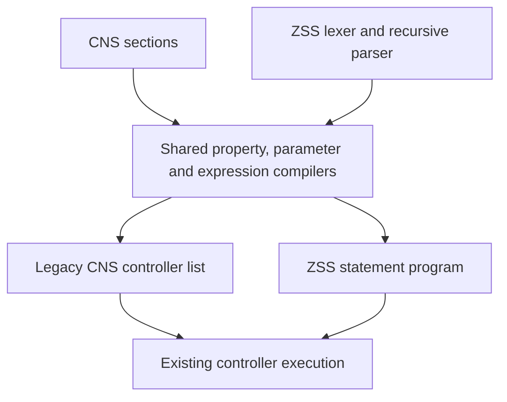

# ZSS compiler and runtime implementation plan

Status: IMPLEMENTATION IN PROGRESS (experimental subset).
Sections 1-16 retain the original research/design baseline; section 17 records
implemented increments, verification and remaining qualification gaps.
Research date: 2026-11-16 (Asia/Jakarta).

Current loader coverage (2026-11-18): explicit `.zss` primary `st`, additional
`st0`..`st9`, and `stcommon`. Constants and CMD remain on the CNS path. Numeric
functions/calls, result bindings and cross-file first-wins lookup are
implemented, including numeric PlaySnd payloads, static F/S prefixes and
PalFX/BGPalFX/AllPalFX local expressions. Numeric aiLevelF, static map lookups,
MapSet/MapAdd/MapReset and numeric DEF defaults are implemented. AssertSpecial
now supports the twenty existing MUGEN flags plus ZSS-only `nocrouch` through
the shared runner and real input consumer. The unchanged upstream KFM stops on
NotHitBy (kfm.zss:87:1). Broader controller payloads, block attributes and
unsupported Ikemen extensions remain open.

## 1. Decision

Implement a native C ZSS front-end and a small structured statement executor.
Reuse this engine's state-property compiler, controller parameter compilers,
controller implementations, trigger implementations and expression evaluator.
Extend the shared expression infrastructure where ZSS needs locals and lazy
control flow. Keep the existing CNS front-end and execution path as the
regression reference.

Do not embed the Go engine, translate ZSS to Lua, or generate a CNS text file
as the production implementation. Those approaches either introduce another
runtime or lose state-block semantics and ownership.

The first supported dialect should be **ZSS with the MUGEN numeric/controller
profile**: ZSS control flow, numeric locals and functions over the engine's
implemented MUGEN triggers/controllers. This is not complete current Ikemen GO
character compatibility. Publish a feature manifest and fail explicitly for
unsupported facilities, including first-class strings, wide integer features,
unsupported map forms, triggers and controllers. Full Ikemen compatibility is a
separate, larger engine project.

## 2. Pinned evidence and scope

Engine under investigation:
[ee508ae95819c4f817919f801386424da84dbd1a](https://github.com/leonkasovan/mugen-unleashed/commit/ee508ae95819c4f817919f801386424da84dbd1a).

Upstream reference:
[Ikemen GO b55af1a13c128c16b4d4331f8f1fe67dcd4f06df](https://github.com/ikemen-engine/Ikemen-GO/commit/b55af1a13c128c16b4d4331f8f1fe67dcd4f06df)
(develop snapshot fetched on the research date). Its source, not moving line
numbers from an older checkout, is the compatibility reference.

Primary source anchors:

| Reference | Relevant code |
|---|---|
| I1 | [compiler.go:494](https://github.com/ikemen-engine/Ikemen-GO/blob/b55af1a13c128c16b4d4331f8f1fe67dcd4f06df/src/compiler.go#L494): tokenizer; scan at 7561 |
| I2 | [compiler.go:7653](https://github.com/ikemen-engine/Ikemen-GO/blob/b55af1a13c128c16b4d4331f8f1fe67dcd4f06df/src/compiler.go#L7653): statement termination, key/value reader, variable names |
| I3 | [compiler.go:7795](https://github.com/ikemen-engine/Ikemen-GO/blob/b55af1a13c128c16b4d4331f8f1fe67dcd4f06df/src/compiler.go#L7795): block attributes, if/else, switch, loops, calls, let and statements |
| I4 | [compiler.go:8395](https://github.com/ikemen-engine/Ikemen-GO/blob/b55af1a13c128c16b4d4331f8f1fe67dcd4f06df/src/compiler.go#L8395): ZSS file compiler |
| I5 | [compiler.go:5659](https://github.com/ikemen-engine/Ikemen-GO/blob/b55af1a13c128c16b4d4331f8f1fe67dcd4f06df/src/compiler.go#L5659): local reads; logical compilation at 6042/6086; expression entry at 6172 |
| I6 | [bytecode.go:4993](https://github.com/ikemen-engine/Ikemen-GO/blob/b55af1a13c128c16b4d4331f8f1fe67dcd4f06df/src/bytecode.go#L4993): function frames, call validation, block execution and loop signals |
| I7 | [bytecode.go:17006](https://github.com/ikemen-engine/Ikemen-GO/blob/b55af1a13c128c16b4d4331f8f1fe67dcd4f06df/src/bytecode.go#L17006): state program and entry/run lifecycle |
| I8 | [compiler.go:7166](https://github.com/ikemen-engine/Ikemen-GO/blob/b55af1a13c128c16b4d4331f8f1fe67dcd4f06df/src/compiler.go#L7166): file dispatch and appended .zss fallback |
| I9 | [compiler_functions.go:2323](https://github.com/ikemen-engine/Ikemen-GO/blob/b55af1a13c128c16b4d4331f8f1fe67dcd4f06df/src/compiler_functions.go#L2323): shared HitDef compiler |
| I10 | [Official ZSS wiki](https://github.com/ikemen-engine/Ikemen-GO/wiki/ZSS): author-facing introduction; source resolves discrepancies |

No native Ikemen runtime, Windows binary, Android APK or Vita VPK was built
during this research. The engine's Linux x86-64 CNS host harness and a temporary
extension of it were run; section 15 records the results.

## 3. Corrections and subtleties to preserve

The supplied architecture description is a useful starting point. These details
need correction or explicit qualification against the pinned implementation:

| Topic | Verified behavior / implementation consequence |
|---|---|
| For loop | It is a begin/end/increment range, with inclusive endpoints, not C's init/condition/update. The end and increment are evaluated at loop entry. A positive step counts upward, a negative one downward; omitted step is +1. A zero step is allowed and reaches the loop guard. |
| For declaration | Use `for i = 0; 3 { ... }`, then read `$i`. Do not implement the supplied `for let $i = ...` spelling as the reference syntax. |
| Controller termination | Use `VelSet { x: 2; y: 0; }` with no semicolon following the closing brace. Assignments, let, call, break and continue do require semicolons. Root-level `statementEnd` also imposes line-boundary rules. |
| Branch execution | A block's if condition is evaluated once per visit. Children changing values used by that condition must not cause later children to re-evaluate it. |
| Switch | The implementation constructs an ordered equality/OR if/else chain. Do not silently hoist a side-effecting header into a single temporary: that can change calls to random or assignments. No C-style fallthrough. |
| Persistence | `persistent(1)` is accepted. Values <= 0 map to the once-only sentinel. Persistence is rejected in functions and negative states. Parent persistence gates a block; it is not a fresh independent countdown attached to every leaf. |
| Hitpause | Inherited execution permission and whether an ancestor must be visited to reach an ignoring descendant are distinct. A single copied boolean is insufficient. Functions receive their permission from the call site. |
| Functions | Duplicate name in one file is an error. Across files, the first definition wins; the later definition is still parsed. Calls without result bindings can discard results; result bindings, when present, must match the callee's result count. |
| Local lifetime | Local slots belong to one state execution or function invocation, not persistent character var/fvar storage. Upstream allocates fresh frames initialized to its no-value representation; reusing a frame must clear old contents. |
| Limits | 256 slots per state/function, including arguments and returns; 2500 is the per-loop runtime guard, not a whole-tick cost bound. |
| Value model | Current upstream also supports string and extended integer facilities. This project's Expr is not the same bytecode or value representation. |
| Reuse claim | ZSS and CNS share semantics inside Ikemen. That does not make Ikemen's expressions or controllers identical to this reconstruction's MUGEN semantics. |

Tests must settle exact side-effect order, loop-control-variable values after
exit, bottom/no-value conversions and line closure behavior before claiming
source compatibility.

## 4. Existing engine: exact integration points

All following paths refer to the engine snapshot in section 2.

| File / entry | Existing behavior | Work needed |
|---|---|---|
| `src/char.c:645–823` | Separately loads command definitions, constants, primary states, st0..st9, CMD states and common states through Ini | Introduce state-source dispatch before Ini parsing; preserve constants and command-definition loading |
| `src/statedef.c:69 StateDef_Parse` | Compiles properties and discovers following CNS controller sections in one function; requires at least one controller | Extract reusable property compilation; ZSS must not manufacture dummy CNS sections |
| `src/statedef.c:316/342` | StateDefs_Load/LoadMore build/grow a KeyedArray of StateDef | Transactional ZSS state installation and a companion program registry |
| `src/sctrl.c:372 StateCtrl_ParseParams` | Shared parameter compilation and type/version checks | Feed native ZSS parameter pairs to the same implementation |
| `src/sctrl.c:1224 StateCtrl_Parse` | Adds CNS trigger1/triggerall and per-controller attributes | Keep this CNS-specific; ZSS owns condition blocks and attributes |
| `src/expr.c:696/996` | Expr_Compile and Expr_Eval use typed postfix tokens | Context-aware local references; ZSS logical jumps; strict parsing and verification |
| `src/trigger.c:500/1372` | Trigger parsing and ordered CNS trigger groups | Reuse trigger implementations; preserve original group short circuit |
| `src/sctrl.c:1352 StateCtrl_Run` | Controller execution plus state-change/AI bookkeeping | Call this shared behavior from the ZSS executor; do not bypass it with direct StateCtrl_Apply |
| `src/statedef.c:408 Player_RunState` | State entry properties, byte counters, flat controller list | Dispatch the ZSS body after shared state entry and before the empty-controller early return |
| `src/statedef.c:547 Player_RunSpecialState` | Own/custom state selection and negative-state execution | Add matching ZSS dispatch here too |
| `src/playerstate.c:34 Player_ChangeState` | Validity lookup uses StateDefs.list | Keep an ordinary StateDef entry for every ZSS state |
| `src/statedef.c:357 StateDefs_Free` | Frees controllers, expressions and the state list | Destroy the matching program registry and function objects |
| `src/char.c:1969/2125/2412` | Player create/free/reset | Own per-player persistent counters and runtime sidecars here |
| `src/playerstate.c:3105` | Precache worker loads characters | Compiler state and registry publication must have explicit ownership/thread rules |

Important constraints:

- `StateDefs`, `StateDef`, `StateCtrl`, `Expr`, `Trigger` and `Player`
  preserve original 32-bit layouts. Do not add pointer fields to them.
- `Player.sctrl_wait` is a 512-entry byte-counter array. ZSS block persistence
  needs separate int32 counters, not reused byte slots.
- A KeyedArray grow can relocate StateDef elements. Never key the new registry
  by a borrowed StateDef pointer.
- Empty or function-only ZSS files need their own valid load result. The CNS
  loaders currently reject files without states/controllers.
- Raw ZSS cannot pass through `Ini_Parse`: it discards semicolon comments, but
  semicolons are ZSS syntax.

## 5. Architecture

Keep two input paths and two body execution paths, sharing controller semantics.



The diagram describes code reuse, not a conversion from ZSS to a CNS list.
Block conditions, branch selection, loop state and function frames remain part
of the ZSS program.

Proposed modules (names are recommendations, not existing APIs):

| Module | Responsibility |
|---|---|
| `src/zss.h` | Public compile/run/free contracts and feature profile |
| `src/zss_lex.c` | Bounded source cursor, tokens and source spans |
| `src/zss_parse.c` | Recursive-descent statements, declarations and headers |
| `src/zss_program.c` | Immutable node arrays, pools, functions, verification, transactional installation |
| `src/zss_run.c` | Explicit execution stack, locals, loops and controller dispatch |
| `src/scriptparams.c/.h` | Parameter reader with CNS Ini and ZSS-pair adapters |
| `src/scriptctx.c/.h` | Explicit compile/evaluation contexts and lifecycle sidecars |
| Existing expression/trigger modules | Shared numeric expressions plus opt-in ZSS token extensions |

A program can use a contiguous node array with child/sibling/else indices,
rather than one heap allocation per node. Nodes hold expression/controller
handles, source-span indices and attribute metadata. Compiled nodes remain
immutable; loop cursors, counters and function frames are runtime data.

Initially execute the structured IR directly. A second optimizing statement
bytecode or binary cache is optional future work, after measurement.

## 6. Shared parameter compilation and strictness

Introduce a small `ScriptParamReader` contract:

- lookup a key; iterate repeated values where a CNS helper requires it;
- preserve raw value bytes, source span and consumed-key information;
- obtain its explicit compile context and language profile;
- report errors without changing unrelated global compiler settings.

Provide one adapter around the selected Ini section and another around parsed
ZSS key/value spans. Existing exported CNS signatures remain wrappers using the
legacy context. Internal shared routines gain explicit reader/context forms.

Extract the property-only part of StateDef_Parse and adapt StateCtrl_ParseParams
and its delegated compilers: HitDef, Projectile, Helper, Explod, PlaySnd, Pause,
PalFX, prefixes, vectors and formatted strings. This is a substantial shared-code
refactor, not just replacing two top-level functions.

Route recursive expression/trigger compilation through the same compile context,
including redirect arguments and expressions inside cond or controller payloads.
An outer parser mode alone does not make those nested paths strict.

For ZSS:

1. Reject duplicate keys before compilation.
2. Reject unknown controller names, unsupported profile features, missing required
   parameters and invalid version use.
3. Check consumed input: a successful prefix parse must not hide trailing junk.
4. Track unused keys and compare the acceptance rules with the upstream compiler.
5. Return a source-aware error and clean up the partial object. Do not call a
   process-aborting legacy parser error path for malformed ZSS.
6. Keep HitDef-style `attr: S, NA` and sound/animation prefixes as parameter
   syntax; not every parameter is a generic numeric expression.
7. Distinguish a block's ignorehitpause attribute from a controller parameter
   with a similar name.

Avoid serializing arbitrary ZSS values to a CNS text buffer and reparsing it.
Quoted semicolons, comment characters, multiline values and string case must
survive intact. Lowercase identifiers/keys for lookup, never string contents.

## 7. Expressions, locals and evaluation contexts

### 7.1 Shared infrastructure, different compilation policy

Retain the existing CNS parser/evaluator behavior. Add explicit context-aware
internal entry points, conceptually:

```c
/* Proposed contracts; exact declarations belong to the implementation. */
int Expr_CompileCtx(const char *text, Expr *out, ScriptCompileCtx *ctx,
                    const char **end, int want);
int Expr_EvalCtx(Player *player, const Expr *expr, ScriptEvalCtx *ctx,
                 int *int_out, float *float_out);
```

The original public functions use the CNS context. Shared controller parameter
compilers and runners must pass the ZSS context when invoked by ZSS. This
requires plumbing through nested trigger evaluation and controller-specific
helper routines, not merely passing context at a file entry point.

Do not add a process-global zssMode or current-locals pointer. Precache may compile
while the engine is active, and nested calls/custom states must restore their
contexts. Prefer explicit contexts throughout. Any temporary scoped bridge
would need separate thread isolation and unwind tests on every toolchain.

### 7.2 Minimal evaluator extension

Preserve Expr's layout and legacy token meanings. Add ZSS-only local-read tokens
carrying slot indices, and conditional jump/pop operations for lazy logical
expressions. Numeric operands use fixed-width data; jump targets are validated
indices within the expression, never pointers cast into int.

A temporary expression AST or span representation during ZSS compilation can
lower to Expr instructions with jumps. Reuse trigger compilation and numeric
operations rather than maintaining another table of trigger/controller meanings.

The verifier must understand control-flow edges: all reachable paths leave one
value, branch destinations are valid, local indices are in range, and maximum
stack use fits the declared execution budget. The existing linear postfix depth
check is insufficient for jumps.

Audit Expr_Free, Expr_Copy/Clone, scaling helpers and Trigger_Copy/Free for the
new token types and nested ownership. Tests must exercise cloning expressions
that contain locals, jumps, redirects and cond branches.

### 7.3 Semantics that need explicit tests

- ZSS `&&` and `||` lazy evaluation, value normalization and bottom handling,
  compared with the pinned upstream. CNS keeps its existing eager operands.
- Eager `ifelse` versus lazy `cond`; do not give both functions the same shortcut.
- Precedence, right/left association, intervals and redirect assignment.
- Local references inside controller parameters, HitDef payloads, cond branches
  and redirected expressions. Redirection changes the player receiving the
  trigger, not the lexical local frame.
- Constant folding only for proven pure constant subtrees. Never fold random,
  assignments, runtime triggers or unsafe mathematical operations. Preserve the
  chosen profile's numeric rounding/overflow behavior.
- Literal parsing must consume the full token and distinguish intentional
  legacy saturation from strict ZSS range errors.

### 7.4 Locals and functions

Use a separate slot count type large enough to represent 256. Valid slot
indices are 0..255; reject slot 257 before narrowing to uint8_t.

For the initial numeric profile, use explicit int32, float32 and bottom/no-value
tags. Do not treat a full native ExprValue union as a fixed four-byte value:
it contains a pointer alternative and grows on 64-bit.

Each state-body invocation gets a fresh local frame. let reassigns the same
state/function-wide slot; nested blocks do not imply C lexical shadowing.
Each function call gets a fresh frame, with arguments first, return slots next,
then temporaries. Clear reused frames. Do not allocate locals in var/fvar slots.

Strings and wide-integer values require a later tagged-value/string-pool design
and controller ABI audit; until then they receive explicit unsupported-feature
diagnostics rather than silent coercion.

## 8. Structured execution and control transfer

Represent body results as a flow enum plus existing controller-result bits.
Keep NEXT, BREAK, CONTINUE, STOP and ERROR distinct. Preserve
STATECTRL_CHANGED and STATECTRL_STOP separately when adapting StateCtrl_Run.
Do not reinterpret every nonzero return as a loop break.

Execution rules:

- An if selects its branch once and executes that branch in order.
- A nested state change or DestroySelf unwinds the old block/function/loop path
  immediately according to the existing controller bits.
- A break is consumed by the nearest enclosing loop. A continue reaches that
  loop's increment/condition phase. No global loopBreak/loopContinue flags.
- A function's frame and expression stack are restored on all exits, including
  a failed call, state change, bottom value, guard limit and allocation failure.
- Resolve functions against the owner of the active state program. A victim
  executing another character's custom state must not accidentally use its own
  function table. Preserve that owner through nested calls and redirects.
- Keep a stable active-program handle while controllers change p->states or
  p->custom_states; do not rediscover the callee owner from a modified player.
- Reset the same AI-command preparation/bookkeeping the CNS path performs.
- Share state-entry property application; do not apply it twice for ZSS.

Use an explicit bounded execution stack to avoid unbounded C recursion on Vita.
For-block counters belong to each invocation; never store running loop cursors
in immutable program nodes shared by helpers or recursive function calls.

## 9. Blocks, persistence, switch and loops

### Persistence and hitpause

Allocate int32 persistence counters per player and active state instance in a
runtime sidecar. Initialize/reset them on entry and release them on player
destruction/reset as appropriate. A same-number state reentry must reset them;
state number equality alone is not an entry test.

Reproduce the reference's countdown order, guard evaluation order and once-only
sentinel. Nested persistence creates nested gates; flattening it onto every
controller changes timing. Test persistence during hitpause and state changes.

Track both direct inherited permission and descendant visitation requirements.
A child marked ignorehitpause must still be reachable through ordinary parents
without making unrelated siblings execute during hitpause.

### Switch

Compile source-order case lists into conditional blocks using the reference's
equality/OR construction and default behavior. Preserve exact evaluation count
for random/assignment headers. Test default-before-case, duplicate default and
case separators. Defer jump-table optimization.

### Loops

Implement `for i = begin; end; increment { ... }` and `for begin; end { ... }`
as range loops. Endpoints are inclusive; begin/end/increment are entry-time
values. The loop body may modify its control variable: the next step must use
the reference behavior, not an independent hidden C counter.

Implement while as a condition checked for each iteration. Enforce the upstream
2500-iteration guard and test off-by-one behavior against the reference.

Proposed additional protections, explicitly engine extensions rather than
upstream guarantees: maximum block/call depth and a deterministic total
instruction budget shared by the entire player invocation. A per-loop guard
alone permits enormous nested work. Select the final budget from a measured
corpus; do not use elapsed wall-clock time as a gameplay abort criterion.

Define signed loop increments without C signed-overflow UB. Qualification must
decide whether the numeric profile wraps or rejects each overflow case.

## 10. Loading, ownership and atomic installation

### File dispatch

Add a state-loading helper over Stream and the character's existing resolver:

1. Resolve the explicitly requested source with existing directory/ZIP rules.
2. Select ZSS only by the final .zss extension (case policy tested).
3. On a missing non-ZSS state source, optionally try the appended .zss filename
   in the same resolution order.
4. Never substitute a fallback because a present CNS file has a syntax error.
   The proposed missing-only policy is deliberately narrower than upstream's
   generic load-error fallback and must be documented.
5. Parse ZSS directly from its owned source buffer, before Ini_Parse.
6. Support st, st0..st9, CMD state portions and stcommon. Leave character
   constants and command definitions on their established CNS/INI paths.

The current loader reads a CMD twice for different purposes. A .cmd.zss fallback
can replace its state portion; it cannot supply missing [Command] definitions.
Likewise, a ZSS state file cannot replace the constants file's [Data]/[Size]/etc.
The first milestone should use an explicit stN = file.zss entry and retain
ordinary cns/cmd resources.

Function-only files must successfully append function definitions even if they
add zero states. Maintain deterministic file order.

### Duplicate and merge policies

- Same-file duplicate ZSS states/functions: hard error.
- Across-file functions: first definition wins, but parse/check the later body.
- Preserve existing CNS collision handling for all-CNS characters.
- For mixed files, specify and test positive-state precedence and negative-state
  composition. Upstream's ZSS branch accumulates existing negative state bodies.
  Do not change the legacy list's duplicate keys as an incidental parser change.
- Map any composition into the sidecar's effective program explicitly. If an
  initial milestone does not support a collision pattern, reject it clearly.
- Reject unsupported special states, such as current upstream's +1 extension,
  until their scheduling semantics exist in the engine.

### Ownership model

Use a registry keyed by (owning StateDefs*, state number) with stable generation
or program handles. Function tables belong to the same owning state collection,
not to a single source file or a currently redirected player.

Parse one file into temporary owned program/controller/expression storage.
Validate and reserve destination capacity before publishing anything. On
failure, release all partial objects and retain previously loaded state tables.
Avoid pointers into a growable KeyedArray or temporary token/source buffer.

Source spans refer to retained filenames/line maps, not a borrowed ZIP entry:
the loader can unload or close its Stream after compilation. Retain source text
only when diagnostics/debugging needs it; runtime requires owned values/IR.

Character unloading destroys program metadata; player/helper unloading destroys
runtime frames/counters. Synchronize compile/publication/free with precache
ownership. Do not insert an unsynchronized reallocating global sidecar table.
Existing Expr parsing also has a process-static recursion-depth counter, so
concurrency must be audited or compilation serialized explicitly during the
context migration.

## 11. ABI and platform design

| Target | ABI issue / qualification |
|---|---|
| Windows x86 | ILP32 reference; all original layout assertions must still pass |
| Windows x64 | LLP64: pointers are 64-bit while long remains 32-bit; no pointer packing |
| Linux x86-64 / arm64 | LP64: long and pointers are 64-bit; use explicit integer-literal and slot arithmetic |
| Android | Current package is arm64-v8a only; test NDK compilation plus actual APK execution; do not claim armeabi-v7a coverage |
| PS Vita | ARM32; constrained RAM/stack and alignment; test VitaSDK build and on-device execution |

Rules:

- Keep legacy layout assertions active as appropriate. Add separate asserts for
  new fixed-width values and offsets; do not disable checks to accommodate ZSS.
- Use sizeof for pointer-bearing allocations/copies, checked size_t arithmetic
  for arenas and uint32/int32 handles for logical indices.
- Do not memcpy a native Expr, Trigger, StateCtrl or pointer table into a
  platform-independent byte stream.
- No binary cache in the first release. A later one needs a version, explicit
  endian/width encoding, feature profile, semantic compiler version, source
  hashes and relocation-free indices.
- Preserve this project's Ftol/Trunc64 and numeric policy. Ikemen's Go numeric
  behavior is not automatically the reconstruction's numeric reference.
- ZSS itself requires no SDL/GL/VitaGL calls or extra runtime dependencies.
- New compilation units are discovered by the root Makefile and Android/Vita
  CMake globs. Add explicit tests, includes and option propagation as needed;
  root MSVC/CMake remains retired.
- If MUGEN_ZSS is a build gate, include it in the root configuration stamp and
  the Android/Vita CMake/build.bat options. Disabled builds must reject a .zss
  resource explicitly, not parse it as CNS.

Do not modify mugen.cfg display dimensions or renderer settings for this work.

## 12. Incremental implementation and acceptance gates

| Phase | Deliverable | Required evidence before proceeding |
|---|---|---|
| Z0: freeze contract | Pinned grammar, numeric feature manifest, duplicate/load policies and reference fixtures | For syntax, controller termination, side effects, loop ranges, locals, hitpause and persistence have explicit expected outcomes |
| Z1: shared compiler seams | Parameter reader and explicit compile/eval contexts; extracted state-property compiler; cleanup ownership | Existing CNS ABI suite and representative game traces unchanged; allocation-failure tests pass |
| Z2: first usable file | Lexer, StateDef/controller parsing, source errors, explicit stN .zss dispatch; simple sequence executor | Synthetic ZSS character executes Pos/Vel/ChangeAnim/ChangeState through existing controllers; state entry and negative-state dispatch covered |
| Z3: expressions and branches | Numeric locals, ZSS logical jumps, if/else, assignment statements, verifier | Side-effect/evaluation-order fixtures match the chosen reference profile; no changes to CNS eager behavior |
| Z4: complete block control | Attributes, switch, for/while, break/continue, per-player counters | Persistence/hitpause traces, loop boundaries/guards, state-change unwinding and two-helper isolation pass |
| Z5: functions | Argument/return slots, first-wins table, forward calls and runtime validation | Nested calls, discarded returns, mismatch no-op, custom-state ownership and recursion limits pass |
| Z6: loader and lifecycle completion | Missing-file fallback, function-only files, ZIP sources, mixed-file composition, reset/unload/precache | No missing commands/constants; failed file loads are atomic; no registry/frame leaks or pointer-reuse errors |
| Z7: platform rollout | Build gate propagation, diagnostics, profiling, supported syntax examples and documentation | Native build matrix plus required device rows; explicit OPEN gaps instead of host-mock device claims |

Z2 is a prototype subset, not a release claiming full ZSS. Z3–Z6 complete the
planned numeric language profile. Keep the feature opt-in until Z7's gates pass.
Do not start by converting all common states or requiring users to rewrite
their existing characters.

Suggested first synthetic input:

```text
[StateDef 200; type: S; movetype: A; physics: N;]
if time = 0 {
    ChangeAnim { value: 200; }
    VelSet { x: 0; y: 0; }
}
if animtime = 0 {
    ChangeState { value: 0; ctrl: 1; }
}
```

Add locals/for/functions only in later fixtures. Use supported numeric parameters
rather than copying an upstream system script containing maps or other missing
engine features.

## 13. Test plan

### Front-end and errors

Token spans and diagnostics for CRLF/LF, optional BOM, comments, case, quoted
delimiter characters, multiline headers, root versus nested terminators,
helper-controller versus helper redirect, intervals, malformed strings/braces,
trailing tokens and unknown parameters.

Check same-file duplicates, function-only sources, cross-file order, 256 versus
257 slots, slot 255 and large/signed state numbers. Bound every source, token,
expression and nesting allocation. Inject allocation failure at each compile
stage and verify zero partial publication and no leaked controllers/expressions.

### Expressions and semantic differential tests

Use three distinct comparisons:

1. Existing CNS build versus candidate CNS path: original behavior must remain.
2. CNS versus equivalent ZSS for the common supported numeric/controller subset.
3. Candidate ZSS versus the pinned Ikemen behavior for isolated language cases
   with matching available builtins.

A flat CNS rewrite is not a valid oracle for nested if semantics. For example,
`if var(0) = 0 { var(0) := 1; var(1) := 2; }` must execute both assignments.
Converting both leaves to independent trigger checks changes the second result.

Test assignments inside false && / true || operands, eager ifelse, lazy cond,
bottom values, integer limits, floats, random-consumption order and redirect
local reads. Match the reference only where the declared profile promises it.

### Runtime and lifecycle

Record ordered controller IDs, local tags/values, state changes and per-tick
persistence counters. Include nested loops, positive/negative/zero steps,
initially empty ranges, end-boundary inclusivity, body-modified loop variables,
break/continue and calls that change state or destroy the helper.

Run multiple helpers sharing one character program, two players in the same
state number, custom states from another owner, same-number reentry, reload,
round reset, player-pointer reuse, failed loads and precache cancellation.

Undefined function or arity mismatch must warn and no-op as specified, with no
argument side effects if validation precedes argument evaluation. A call that
ignores returned values is valid. Measure and bound warning repetition without
silently changing call behavior.

### Platform / tooling

Extend tools/test_cns_abi.sh; add headless test_zss_parse, test_zss_expr,
test_zss_run and test_zss_load harnesses. Put scripts into qualification/CI with
explicit ABI assertions and sanitizer variants. Real compiler/VM paths must be
linked; do not stub away the expression/controller feature being asserted.

Require Windows x86/x64, Linux x64/arm64 and Android arm64 native compilation.
VitaSDK compilation and actual Vita runs are separate rows. Runtime device
qualification must include hitpause, custom states, functions, loops and cleanup,
not just reaching the title screen. Missing toolchains/devices remain OPEN.

Game verification: deterministic fixed-seed CNS baseline logs, a small converted
test character, state/variable traces and repeatable gameplay inputs. Screenshot
or mugen.log equality alone cannot prove compiler semantics. Do not change
display size to facilitate testing.

## 14. Memory and performance plan

Compile at character load/precache time, never parse source while running a
state. Use owned arenas for tokens/IR and pooled runtime frames. Free the AST
after lowering; retain only necessary diagnostics. Avoid persistent full-size
256-slot arrays on every inactive helper.

Report compile time, peak compile heap, retained program bytes, expression
instructions, nodes/controllers, maximum local/call depth, loop iterations,
controller execution count and steady runtime allocations. Add a symbol/state
name to expensive-script diagnostics.

Keep the state-program registry out of per-controller hot lookups: resolve once
per state-body invocation. Cache function handles only within the owning program
generation. Use the existing memory profiler; no dependency is needed.

Arithmetic example, not a measured memory result: if numeric slots occupy eight
bytes, 256 slots cost 2 KiB per frame, and 64 fully populated call frames cost
128 KiB before IR/controller storage. This is why Vita needs explicit frame and
call-depth budgeting, not an unbounded C call stack.

Benchmark CNS versus the supported ZSS equivalents with fixed tick counts and
identical inputs; also report worst-case loops and first-use allocations. Make
performance changes only after semantic gates pass.

## 15. Research verification actually performed

On Linux x86-64, a temporary copy of tools/test_cns_abi.c was compiled with the
same production expression, trigger, controller and state units as its runner.
Only the existing test boundaries for INI/player output/variable triggers were
used. The memory-profiler wrappers were disabled for the standalone harness.

Observed:

```text
abi: 64-bit build
probe: false && assignment leaves var(0)=9
probe: 1+2 compiled token count=3 (constant marker=-1)
ok: CNS ABI regressions passed
```

Thus this engine currently evaluates that assignment despite a false left
operand, and does not fold the 1+2 example into its constant marker. These are
implementation facts, not recommendations to change CNS.

The upstream Go sources and license were fetched at the pinned revision and
inspected. No full upstream parser/runtime was executed. Exact compatibility
fixtures in Z0 are still required. No ZSS implementation, APK/VPK, performance
savings or native device qualification is claimed.

## 16. Risks and decisions to settle first

| Risk | Mitigation / decision |
|---|---|
| Calling syntax support “Ikemen compatibility” | Name and version the numeric/controller profile; list unsupported builtins and value types |
| Changing existing CNS while adding lazy expressions | Preserve legacy wrappers and token behavior; test old and new paths separately |
| Incomplete context propagation | Audit every delegated parameter parser, nested trigger and runtime expression call |
| Shared state pointers invalid after growth | Registry keyed by stable owning collection/number and generation handles |
| Mutable counters in compiled blocks | Per-player state-instance counters and per-invocation loop/frame data |
| Hitpause/persistence drift | Ordered tick traces against pinned upstream and equivalent CNS where applicable |
| Wrong function owner in custom states | Resolve from active program ownership, not redirected player data |
| Unbounded nested work on Vita | Loop guard plus explicitly documented call/block/total-work limits |
| Partial loads or failed compile leaks | Temporary ownership, reserve-before-commit, allocation-failure tests |
| Precache/global parser races | Explicit contexts, audited publication/free, serialization until reentrancy is proven |
| Copying Go implementation introduces dependencies | Reimplement in C using existing infrastructure; no Go runtime or new library |
| Source adaptation attribution | Preserve the pinned Ikemen MIT copyright/permission notice for copied or translated implementation portions, with provenance recorded |

Recommended first implementation task: Z0 and Z1, followed by the explicit
stN-based Z2 prototype. The main engineering cost is safe shared compiler/runtime
integration, not recognizing braces and keywords.


## 17. Implementation progress

2026-11-16: the allocation-free native C lexer is implemented in
`src/zss_lex.c/.h`, with regression coverage in `tools/test_zss_lex.c/.sh`.
It retains raw length-delimited source spans and tracks lines/columns, including
BOM and CRLF handling. Comments, numeric exponents, operators, locals, string
delimiters, token bounds and sticky errors are covered. The caller owns source
lifetime and selects a token-size bound. This is the lexical portion of Z2;
Z1 compiler-context/parameter interfaces and the remaining parser/runtime work
are still pending. No .zss file is dispatched or executed yet.

Verification: Linux x86-64 warning-clean lexer tests; ASan/UBSan with leak
detection disabled because LeakSanitizer cannot run under this environment's
ptrace; Android-preprocessor host variant; existing CNS ABI regression suite.
The Android variant is not an NDK build or a device pass. No native Windows
or Vita toolchain qualification was performed.

### Controller bridge increment

The next increment adds `scriptparams.c/.h` and `zss_controller.c/.h`.
`Zss_CompileController` parses one standalone controller, then invokes the
existing `StateCtrl_ParseParams`; it publishes an owned StateCtrl only after
success. The native parameter adapter creates a normal owned Ini directly,
without calling Ini_Parse or stripping quoted semicolons. Keys are canonicalized
without mutating global INI case settings. Source-line mappings are retained.

Enabled prototype controllers: VelSet, VelAdd, PosSet, PosAdd, CtrlSet,
ChangeState, ChangeAnim, Turn, Null, DisplayToClipboard, AppendToClipboard and
ClearClipboard. Each has an explicit accepted-key schema. Complex payload
controllers remain rejected until their partial-parse ownership is audited.

This increment uses existing MUGEN expression semantics. Explicit expression
contexts, ZSS short circuit, locals, block/file parsing, loader dispatch and
execution are still pending; it does not enable .zss characters. Current bounds
are 1 MiB per standalone source, 128 user parameters and 63 tokens per parameter;
these prototype limits must be revisited against the reference corpus.

Tests: `sh tools/test_zss_controller.sh` links the real INI, controller,
expression and trigger parsing implementations in the existing CNS host harness.
It checks numeric expressions, var references, literal delimiters/case, duplicate
and unknown keys, malformed input, unchanged output on failure, and allocation
failure cleanup. Shared controller subsystems outside the enabled subset retain
the harness's existing explicit stubs. Linux CI now runs CNS, lexer and controller
bridge gates. Native Windows/Android/Vita qualification remains OPEN.

### StateDef header increment

Added `Zss_CompileStateHeader` in `zss_statedef.c/.h`. It parses one header,
checks the signed 32-bit state number, rejects duplicate/unknown properties and
invalid literal type letters, and invokes the shared property compiler.
`StateDef_CompileProperties` and `StateDef_FreeProperties` were extracted from
`statedef.c`; CNS now uses the same routines with its original defaults, negative
state behavior and numeric semantics. Original structure layouts are unchanged.

`zss_params.c/.h` factors the controller parameter scanner into a reader also
used by state headers. It distinguishes the header closing bracket from brackets
inside interval expressions. Output owns only properties; no controller list is
created and the header cannot yet be installed into a StateDefs collection.
Both the output header and state number are unchanged on compile failure.

The existing bridge gate now checks header defaults, compound/variable/vector
properties, intervals, signed integer boundaries, malformed headers, partial
compilation cleanup and injected allocation failures. File bodies, expression
contexts, locals, block execution and file dispatch remain pending.

The sanitizer test of an empty header exposed a missing sentinel pointer in the
native parameter adapter. The adapter now reserves and initializes that pointer
for empty groups; the empty-header regression exercises the real INI path.

### Owned state-program and body increment

`zss_program.c/.h` now compiles a bounded in-memory source into an owned opaque
program: multiple StateDefs, the enabled leaf controllers, and nested
if/else-if/else bodies. Duplicate states, unsupported statements and malformed
bodies fail without publishing partial output. Compiled expressions, controller
payloads and properties survive release of the source. Arena growth uses stable
indices and allocate/copy/publish ownership. Prototype limits are 64 states, 1024
nodes, 32 block levels and 1 MiB source; root statements require line boundaries.

An isolated explicit-stack body executor evaluates a guard once per visit and
dispatches selected leaves through a callback carrying original STATECTRL bits.
State-change/stop results unwind the old body immediately. Guards use real
MUGEN expression evaluation, including float truth values. The production
callback must eventually call StateCtrl_Run and provide state-entry, AI and
hitpause bookkeeping; those engine hooks are not installed by this increment.

Program compilation explicitly rejects locals and &&/|| in expressions rather
than silently promising ZSS short circuit using the current eager CNS evaluator.
Loops, functions, attributes and assignment statements are not enabled.
The compiler does not yet resolve .zss files or install programs into StateDefs.

The host bridge gate also tests program ownership, duplicate/malformed states,
else selection, one-time guard evaluation after side effects, float conditions,
stop propagation, empty bodies, arena growth, nesting limits and allocation
failure cleanup. Runtime tests inject a recording controller-dispatch boundary;
they do not claim end-to-end gameplay/controller execution or native device
qualification.

### Experimental engine integration

Explicit additional sources in character DEF `st0` through `st9` entries now
dispatch `.zss` files before INI parsing. The primary st/cns source, command
definitions and common-state loader retain their existing paths. There is no
automatic .cns.zss fallback yet. Use unused state numbers: collisions are rejected
both when installing ZSS and when subsequently loading CNS into a bound state.

Installation builds a replacement keyed array transactionally. A private
SCTRL_ZSS_BODY controller owns a reference to the program and dispatches leaves
through StateCtrl_Run, preserving the existing state entry, controller result,
hitpause and negative-state loops. Original structures and their layout checks
are unchanged. Installed headers borrow immutable property expressions from the
retained program; StateDefs_Free releases bindings rather than double-freeing
those expressions. There is no process-global program registry. Install/free
operations follow the existing character/StateDefs ownership lifecycle and must
not run concurrently on the same collection/program.

The outer state loop resets command hints; guarded leaves preserve those hints
for the existing AI state-change bookkeeping. Detailed AI/custom-state behavior
and concurrent precache qualification remain OPEN. No new attributes, locals,
loops, functions or lazy expression semantics are enabled by this integration.

For diagnostics, MUGEN_ZSS_TRACE=1 at load time enables at most four body-result
log entries per installed state binding. Default logs remain unchanged.

Example DEF entry (keep ordinary cns, st, cmd and stcommon resources):

```text
st9 = experimental.zss
```

Example extra state file, entered via an ordinary CNS ChangeState controller:

```text
[StateDef 65000; type:S; movetype:I; physics:N; ctrl:0;]
if time=0 { ChangeState{value:65001;ctrl:0} }
[StateDef 65001; type:S; movetype:I; physics:S;]
CtrlSet{value:1}
```

Validation on Linux x86-64: the full native engine linked with MUGEN_MODEL3D=0,
using the existing SDL2 dependency set. A missing private glib development header
package was extracted into the disposable test subtree; no project dependency
was added. An offscreen System-renderer KFM smoke test used a copied installation
and explicit st9 file. The log recorded:

```text
Loading cns zss-smoke.zss...OK
ZSS state 65000 body result 5
ZSS state 65001 body result 0
```

Result 5 contains the existing stop/state-change bits and confirms native leaf
dispatch and transition into the second ZSS state. The run was bounded by a
12-second timeout (exit 124); the engine logged cleanup and successful termination
after the termination signal. It was not a completed match or a determinism
comparison. Original install files and display dimensions were not changed.

Host tests cover atomic installation, existing-state preservation, collision
rejection, retained references, collection destruction, memory Stream loading
and allocation-failure rollback. Their Stream reader is an explicit I/O boundary;
the native smoke run exercised the real file/Stream path. Native Windows,
Android, Vita, ZIP characters, complete gameplay and unsupported language
features remain unqualified.

### Assignment and while-loop increment

The program compiler now accepts side-effecting assignment statements with a
required semicolon, while loops, and lexically checked break/continue statements.
It reuses the existing MUGEN numeric expression compiler/evaluator, including
var/fvar assignment behavior. A bare expression without an assignment is rejected.
Locals and lazy &&/|| expressions remain explicitly unsupported. For loops,
functions, let declarations and block attributes are not enabled yet.

Body execution now uses bounded sequence/loop frames. Conditions are checked
each iteration; break exits the nearest loop, continue advances that loop, and
controller state-change/stop bits unwind the whole old body. Iteration counters
are invocation-local, so repeated runs and shared programs do not reuse cursors.
There are no loop-time allocations or C-recursive execution calls.

A loop is stopped after 2500 iterations; execution then continues after that
loop. Its warning is limited to once per body invocation. A separate deterministic
100000-control-step budget aborts the current body with STATECTRL_STOP when
nested work is excessive. This additional budget is an engine-specific safety
rule, not a claim about upstream Ikemen semantics. It is a prototype limit to
qualify against a real corpus. No wall-clock timing controls gameplay.

Verification: Linux x86-64 controller/program tests pass under ASan/UBSan
(leak detection disabled in this environment), including nested loops,
break/continue, numeric assignments, state-change unwinding, loop and total-work
guards, fresh execution frames and injected allocation failures. Existing CNS
and lexer suites pass. An Android-preprocessor host syntax check passes; this
is not an NDK build or a device qualification.

The full native Linux engine linked with MUGEN_MODEL3D=0. In a copied offscreen
KFM fixture, state 65000 initialized var(0), incremented it in a while loop,
continued at 2, broke at 4, and changed to state 65001 only if the result was 4.
The native log showed state 65000 returning result 5 and state 65001 executing,
confirming the assignment/loop path reached the real controller runner. The
12-second run used the same bounded smoke-test procedure as the preceding
integration increment; it is not a completed match or determinism comparison.
Original game files and display dimensions were not changed.

### Anonymous for-range increment

The experimental program compiler now accepts anonymous inclusive integer ranges:

```text
for 0; 3 { ... }       # four visits, default increment +1
for 3; 0; -1 { ... }   # four visits, descending
for 0; 5; 2 { ... }    # three visits
```

This is range syntax, not C-style init/condition/update. Begin, end and increment
are evaluated once, left to right, on each entry. Values use the existing MUGEN
numeric evaluator and explicit integer conversion (floats truncate, bottom gives
zero). This remains the documented MUGEN numeric profile, not complete upstream
expression compatibility. A positive increment uses <= end, a negative increment
uses >= end. A zero increment repeats until break/state-change or the loop guard,
even when begin/end would be reversed for a positive increment.

The counter and evaluated endpoints live in invocation-local execution frames.
Nested break/continue target the nearest loop, continue still advances the range,
and controller stop/state-change unwinds the body. Signed 32-bit addition wraps
through int64 arithmetic with explicit reduction; it does not rely on C signed
overflow or pointer width. The 2500-iteration and total-work guards still apply.
A naturally exhausted 2500-visit range does not produce a guard warning; a range
that would need another visit does. Endpoint wraparound can keep a range alive,
so it is deliberately covered by the guard tests.

Named counters (`for i = ...`, `$i`) are rejected pending numeric local-variable
contexts. Anonymous expressions starting with an identifier must be parenthesized,
as in `for (var(0)); 3 { ... }`, to avoid the reference's named-counter dispatch.
Do not describe all for syntax as supported. Locals/let, functions/call, switch,
block attributes and lazy &&/|| expressions remain pending.

The boundary tests also found a token-lowering defect: spacing the minus away
from `2147483648` caused the legacy compiler to clamp the positive token before
negating it. Numeric tokens now stay adjacent to a preceding minus in program
expressions and header/controller parameter values. The regression verifies
`-2147483648` through assignment, conditional comparison and controller evaluation.
Existing CNS parsing is unchanged.

Verification completed on Linux x86-64:

- Real compiler/evaluator host tests pass under ASan/UBSan (leak detection disabled
  in this environment); tracked allocations and injected calloc failures cover
  partial range-header ownership and rollback.
- Fixtures cover inclusive/default/descending/nonunit/zero increments, reversed
  bounds, float conversion, exact guard boundaries, signed counter wrap, one-time
  endpoint evaluation, repeated invocation, nested break/continue, state-change
  unwinding, malformed headers and unsupported named counters.
- Existing CNS and lexer suites pass. Both changed production units pass a host
  syntax check with ANDROID_PORT and -Wall -Wextra -Werror. This is not an NDK build.
- The full native engine links with MUGEN_MODEL3D=0. A copied KFM installation
  enters ZSS state 65000, runs ascending and descending ranges plus a range with
  continue/break, and changes to 65001 only when var(0)=10 and var(1)=4. The log
  records the load, result 5 from state 65000, execution of 65001, and clean shutdown
  after the 12-second timeout. Original game files and display dimensions remain
  unchanged. This is a smoke test, not full-match or determinism qualification.

Native 32-bit/Windows toolchains, Android NDK and VitaSDK were unavailable for
this increment. Their builds and device behavior remain open qualification work.

### Numeric local frames and named for counters

Added explicit ExprCompileCtx/ExprEvalCtx entry points to the shared expression
compiler/evaluator. The original exported CNS signatures are NULL-context
wrappers. Trigger arguments, redirect arguments, intervals/groups and cond's
owned nested Exprs propagate their context. No process-global current-locals
pointer or ZSS mode was introduced. The original global expression operand stack
and legacy diagnostic state remain; this is not a thread-safety qualification.
Expr, Trigger, Player and original StateDef layouts are unchanged.

EXPR_LOCAL is a scalar slot operand (0..255), not a pointer or an overloaded
character var/fvar index. The compiler resolves names through a callback and
keeps only indices in the owned expression. Source spans and the compile context
can disappear after compilation. The verifier counts local reads as operands;
free/copy/clone retain ordinary scalar ownership. Evaluation checks frame bounds
and accepted value types before reading a local; a rejected direct local read
restores the previous operand-stack top.

Supported in this increment:

```text
[StateDef 200]
let total = 0;
for i = 0; 3 { let total = $total + $i; }
var(0) := $total;
let index = 2;
var($index) := $total;
```

- Single-name numeric let declarations and reassignment (`let total = ...;`).
  The `_` binding evaluates and discards its value without consuming a local slot.
- Numeric local reads in body expressions, if/while conditions, range headers,
  trigger arguments and nested cond expressions. Original numeric operations,
  conversions and bottom behavior remain the MUGEN profile, not full Ikemen
  expression equivalence.
- Anonymous and named inclusive for ranges. Named counters share the state's
  local table. A body assignment to its counter changes the value used for the
  next increment. Begin/end/increment are evaluated once on entry; the initial
  binding retains its numeric type, while subsequent counter steps use int32
  conversion and defined wrapping arithmetic. The final local remains the last
  executed body's value when the range exhausts. The existing guards remain.

Names are state-wide compile-time bindings, rather than C block-scoped variables.
A declaration enters scope before compiling its initializer; uninitialized or
conditionally skipped bindings read as bottom. Each body invocation allocates a
fresh bounded value/type frame, initialized to bottom. Reentrant runs and shared
programs have distinct frames. Locals are neither character variables nor values
persisting between ticks. The 256-slot limit is enforced, and redeclaring an
existing name reuses its slot.

Current explicit exclusions: multi-name let/return binding, local `:=` assignment
(use let reassignment), locals in controller or StateDef parameters, functions/
calls, switch, persistence/hitpause attributes and lazy &&/|| compilation. The
parameter reader still rejects local tokens before the legacy controller parser.
Its context plumbing is the next integration step; the leaf runtime must receive
the same explicit frame before parameters containing locals can be enabled.

Validation on Linux x86-64:

- The ZSS/controller host gate passes under ASan/UBSan with leak detection disabled
  in this environment. It covers local type/bottom reads, slot 255 and overflow
  rejection, unknown/out-of-state names, fresh/reentrant frames, body-mutated
  named counters, float initial counters, loop-guard final values, nested
  break/continue, allocation-failure rollback and unsupported forms.
- Explicit expression probes exercise real compilation, nested cond evaluation,
  local trigger arguments, cloning/freeing, unknown nested bindings, recursive
  depth rollback, and invalid direct local frame/index/type checks. var/fvar
  access and controller dispatch remain declared host-test boundaries; cond's
  evaluation helper is shared with the real trigger runner.
- Existing CNS and lexer suites pass. The review-regression suite also passes
  under ASan/UBSan with MUGEN_MEMPROF_NO_WRAP=1 for the standalone harness; its
  trigger-parser boundary was updated to the new context entry point.
- The four changed production C units pass -Wall -Wextra -Werror syntax checks
  on the host, including an ANDROID_PORT check. This is not an NDK build.
- The full native engine links with MUGEN_MODEL3D=0. A copied KFM smoke fixture
  computes 6 with a named range, stores it through var($index), reads it through
  cond and playerid($actor), and runs a local-controlled while loop. State 65000
  changes to 65001 only after both checks pass. The native log records result 5,
  execution of state 65001, and orderly shutdown after the 12-second timeout.
  Root redirection was not qualified by this regular-player fixture.
- A native parent-commit engine was built separately. Plain-CNS quick-VS smoke
  runs of parent and candidate produced 195 fragments each, identical with
  tools/compare_logs.py numeric normalization. This is log-level regression
  evidence, not a gameplay-state/determinism comparison or a completed match.

Original installations and display dimensions were not changed. Native 32-bit,
Windows, Android NDK and Vita builds/devices remain open qualification work.

### Local controller-parameter integration

The audited controller subset now compiles local parameter expressions through
Zss_CompileControllerCtx and StateCtrl_ParseParamsCtx. The token reader permits
local tokens only when a lexical compile context is present. StateDef properties
and the legacy standalone-controller wrapper retain their rejection of locals.
Unknown names, duplicate/unknown keys, malformed or partially consumed numeric
parameters, and unsupported controllers fail before a program is installed.
Lazy &&/|| parameters remain rejected in the context-aware profile.

The enabled set is unchanged: VelSet, VelAdd, PosSet, PosAdd, CtrlSet, ChangeState,
ChangeAnim, Turn, Null, DisplayToClipboard, AppendToClipboard and ClearClipboard.
An engine-owned capability table now supplies the bridge's name check and the
runtime's type check. StateCtrl_ParseParamsCtx refuses unsupported types when a
compile context is supplied; StateCtrl_ApplyCtx stops a context-bearing invocation
of an unsupported type. Adding an entry alone is not enough to expand this set:
its nested compile helpers, runtime reads and failure ownership must be audited.

The shared numeric key/XYZ helpers and formatted expression-list reader take an
explicit compile context. Cns_ParseValues and Cns_ParseValuesCtx share one va_list
implementation. Legacy signatures remain wrappers passing NULL; no global mode,
current-frame pointer, local-to-character-var remapping or token substitution was
introduced. String literals such as "$x=%i" remain literal text. Compiled local
parameters retain slot operands, not values captured while compiling a file.

ZssControllerRun now receives the borrowed current ExprEvalCtx in addition to its
adapter context. The engine adapter calls StateCtrl_RunCtx, preserving snapshots,
stop/state-change bits and the existing AI bookkeeping. StateCtrl_ApplyCtx and the
supported animation/clipboard helpers evaluate parameters with that same frame
at their original read sites. A float context wrapper shares the existing numeric
conversion/bottom semantics. None of the original engine struct layouts changed.

In particular, ChangeState still evaluates its state number before changing state,
then reads ctrl and anim afterward. The outgoing local frame remains live during
those post-change reads. Parameters are not eagerly replaced with constants before
dispatch. Subsequent controllers in the old body stop executing on STATECTRL_STOP.
A callback must not retain its borrowed frame; reentrant state executions receive
separate frames, so inner slot values cannot overwrite the outer caller's values.

Validation completed on Linux x86-64:

- The ZSS/controller host suite passes under ASan/UBSan (leak detection disabled
  in this environment). New tests cover each supported numeric parameter schema,
  nested cond/local expressions, changing local values across controller visits,
  loop-index parameters, multi-value clipboard formatting, append behavior,
  literal dollar strings, nested/reentrant frame preservation, unknown locals,
  trailing comma values, duplicate/missing keys, unsupported complex controllers,
  and failure injection through temporary INI/text/expression ownership.
- Existing CNS and lexer tests pass. The review-regression suite passes under
  ASan/UBSan with MUGEN_MEMPROF_NO_WRAP=1 for its standalone boundary harness.
  Host syntax checks with -Wall -Wextra -Werror pass for the six changed production
  C units, including an ANDROID_PORT check; that is not an Android NDK build.
- The full native engine links with MUGEN_MODEL3D=0. A copied offscreen KFM fixture
  executes every enabled controller type. It uses local values for CtrlSet,
  PosSet/PosAdd, VelSet/VelAdd, ChangeAnim, ChangeState and clipboard parameters;
  checks animation/control/position/velocity in the same body; and checks the
  new state's control/animation before entering a success state. The native log
  records 65000 -> 65001 -> 65002, with body results 5, 5 and 0 respectively, and
  no visit to the fixture's failure states 65010..65013. The ChangeState ctrl
  expression is cond(stateno=$target,$one,0), so this specifically exercises its
  post-change evaluation with the outgoing local frame. A trailing CtrlSet(0)
  in the old body must be skipped for the success state to be reached.
- Native parent/candidate plain-CNS quick-VS runs each yield 195 log fragments,
  identical with tools/compare_logs.py numeric normalization. This is regression
  evidence, not a gameplay-state/determinism equivalence claim. All native runs
  are bounded smoke runs; the ZSS run exits on its 12-second timeout with orderly
  cleanup, rather than completing a match.

Original game trees and display dimensions were not changed. Windows/32-bit,
Android NDK and Vita/device qualification remain open. Functions/call, multi-name
bindings, local := syntax, switch, persistence/hitpause attributes, lazy logical
compilation, broader controller payloads and StateDef-local expressions remain
outside the supported profile.

### Short-circuit logical expressions

Explicit-context compilation now enables && and || in ZSS body expressions,
conditions, range headers and the audited controller parameters. Ordinary CNS
compilation still emits its original eager logical operators. This distinction
is selected by the explicit compile entry point, not a global language flag.
StateDef header logical expressions remain rejected until their context is
integrated; the legacy standalone header/controller APIs retain the MUGEN dialect.

Reference behavior was rechecked against the pinned compiler's expBoolAnd /
expBoolOr ([compiler.go:6042](https://github.com/ikemen-engine/Ikemen-GO/blob/b55af1a13c128c16b4d4331f8f1fe67dcd4f06df/src/compiler.go#L6042))
and [BytecodeValue.ToB](https://github.com/ikemen-engine/Ikemen-GO/blob/b55af1a13c128c16b4d4331f8f1fe67dcd4f06df/src/bytecode.go#L1342)
/ the [conditional jumps](https://github.com/ikemen-engine/Ikemen-GO/blob/b55af1a13c128c16b4d4331f8f1fe67dcd4f06df/src/bytecode.go#L2252).
Dynamic logical paths retain the selected operand's value and type. They do not
uniformly produce 0 or 1. Constant logical combinations normalize to a boolean.
The context parser uses the reference's right associativity for these operators;
CNS associativity is unchanged. For example:

```text
let x=7;
let selected=$x || (var(0):=99);  # selected is 7; assignment is skipped
let normalized=2 || 3;          # normalized is 1
let chained=0;
let chained=$chained || 2 || 3;  # right constant subtree yields 1
```

The compiler determines numeric dependencies without evaluating triggers or
mutating gameplay while compiling. Literal/arithmetic subtrees, supported pure
math calls, PI/E, and constant cond/ifelse trees normalize logical results as the
reference's constant logical fold does. Variables, locals, RNG, assignments,
redirections and branches containing those dependencies stay dynamic. Both
branches are still parsed and validated, including dead operands. This is not
an aggressive constant-folding optimizer: arithmetic and math evaluation still
use this project's MUGEN numeric implementation and warnings. Full Ikemen
numeric/controller equivalence is not claimed.

Compilation first produces the shared, verified postfix input IR. Only the
complete Expr_CompileCtx result is lowered, after inline trigger arguments have
been assembled. Owned cond/redirect Exprs compile independently. New scalar
EXPR_SC_AND / EXPR_SC_OR instructions hold relative forward displacements;
EXPR_BOOL normalizes a pure logical result. A bounded tree/emission stack avoids
recursive lowering. There are no branch-owned heap objects and no pointer/int
encoding. The original Expr/Trigger layouts and CNS 128-token input limit remain
unchanged. Lowered code is bounded to 256 words before legacy helper appends.
Scratch lowering arrays are used only on the explicit-context logical path.

The control-flow verifier checks both jump and fallthrough stack effects,
consistent depths at merges, operand-stack limits, forward/in-range targets,
exactly one final value, and instruction boundaries. In particular, the trailing
comparison tag of a MUGEN interval is payload, never a valid jump target. Runtime
jumps check their scalar bounds before addition and respect the current nested
expression's stack base. Missing contexts or invalid direct jump encodings fail
without leaving operands behind. Execution adds no recursive logical walker or
per-evaluation heap allocation; the existing cond evaluator remains recursive.

Logical truth treats zero, bottom and NaN as false. Selected dynamic operands
retain their numeric representation. ZSS if/while and context-bearing cond truth
checks also handle NaN as false. The NULL-context CNS behavior is unchanged.
The legacy bitwise-not parser and evaluator disagree about operand count; ZSS
now rejects ~ explicitly rather than certifying inconsistent stack behavior.
CNS retains that documented quirk. Context parser operator-stack exhaustion is
also a normal compile failure, rather than a process-aborting legacy error path.

Ownership stays atomic: parsed triggers remain owned until lowered arrays are
published together. Failure frees the original parse exactly once. Jump markers
own scalar values only, so ordinary free/copy/clone behavior remains valid;
relative targets also reach operations appended by Expr_MulFloat/Expr_Halve.

Validation completed on Linux x86-64:

- ASan/UBSan host tests pass (leak detection disabled in this environment), with
  allocation-failure coverage for nested owned cond/jump expressions. Fixtures
  cover skipped assignments, selected operand values/types, right-associated
  chains, literal/arithmetic/constant-cond normalization, float/bottom/NaN truth,
  skipped division warnings, intervals, nested cond, clone ownership, appended
  scaling operations, malformed jump/merge/tag destinations and code growth past
  the original postfix size. Oversized right-associative parses fail cleanly.
- RNG tests count calls at the explicit host trigger boundary: a skipped random
  operand causes no dispatch. They do not qualify RNG distributions or compare
  an Ikemen runtime. A separate assertion confirms CNS still runs the assignment
  in 0 && (var(1):=9), while the ZSS version skips it.
- Existing CNS, lexer and review-regression suites pass. The review harness uses
  MUGEN_MEMPROF_NO_WRAP=1; sanitizer leak detection is disabled there too. The four
  changed production C units pass -Wall -Wextra -Werror syntax checks on the host,
  including ANDROID_PORT. This is not an NDK link or an APK test.
- The full native engine links with MUGEN_MODEL3D=0. A copied KFM smoke fixture
  tests skipped assignment effects in if/while/range headers and controller
  parameters; dynamic operand selection; constant math/ifelse normalization;
  eager ifelse versus lazy cond; and a logical ChangeState value selecting 65001.
  Only the conjunction of its value/counter checks reaches the success state.
  Native logs show 65000 result 5 followed by 65001, then orderly cleanup after
  the 12-second timeout. No original assets or display dimensions were changed.
- Native plain-CNS parent/candidate quick-VS logs each contain 195 fragments,
  identical after tools/compare_logs.py numeric normalization. This is a bounded
  smoke/log regression, not a completed match or gameplay determinism proof.

Windows/32-bit, Android NDK and Vita/device builds remain unqualified here.
Functions/call, multi-name bindings, local :=, switch, persistence/hitpause
attributes, broader controller payloads and StateDef-local contexts remain open.

### Switch and grouped blocks

Switch now compiles to an ordered conditional chain, using the pinned
[reference construction](https://github.com/ikemen-engine/Ikemen-GO/blob/b55af1a13c128c16b4d4331f8f1fe67dcd4f06df/src/compiler.go#L7925):

```text
switch $mode {
    default: CtrlSet{value:0}
    case 1; 2: CtrlSet{value:1}
    case 3: { Turn{} }
}
```

Case values are separated by semicolons, labels end with a colon, and case bodies
end at the next label or switch closing brace. Empty bodies are valid and a
matching empty case stops the chain. Duplicate case values are allowed (first
match wins); duplicate defaults and empty switches fail. Default may appear
anywhere in the source but runs only after every ordinary case fails. A switch
containing only default never evaluates or compiles its unused header, matching
the reference. Standalone brace groups are now supported too; they inherit loop
nesting and keep the state's existing local-variable scope.

Guards retain the reference's `header = value || header = value ...` text
construction and precedence. No extra parentheses or cached header value are
inserted. Parenthesize side-effecting or compound operands when grouping is
intended. A header can run once per attempted case value; OR short circuit skips
later values after a match. Case guards use the shared MUGEN numeric/expression
profile and explicit local context. MUGEN interval comparisons work as case values.
This does not introduce a separate switch equality/value model.

Break and continue are still loop-only signals: a switch does not create a loop
or a C-style break target. Inside a loop they unwind to that loop; outside one
they are compile errors. Controller stop/state-change bits unwind the entire
old body. Internal conditional-case nodes tail-dispatch their next guard/body,
so long flat case chains do not consume a frame per failed label. Existing
statement execution and the total-work guard otherwise remain unchanged.

Bounds: 63 tokens per header/value, fewer than 128 generated lexical tokens per
combined case guard, plus the shared postfix/code verifier limits. Across one
program, generated guard text is capped at 2 MiB to bound repeated-header
expansion. This is an engine-specific prototype budget, not an upstream limit.
It is independent of the existing source/node/state/block bounds. Scratch buffers
use checked sizes and owned allocate/copy/publish operations; every failure path
releases the header, current value/guard and all partially compiled nodes.

Validation: Linux x86-64 ZSS tests pass under ASan/UBSan (leak detection disabled),
including default-first/middle/only, empty matches, no fallthrough, duplicate
labels/defaults, repeated-header and operand-order effects, raw precedence,
interval/float/int32-minimum values, nested switches/groups, loop signals,
state-change unwinding, 200-case dispatch, malformed syntax, guard token/expansion
limits and injected calloc failures. The RNG probe counts the explicit host
trigger dispatch boundary: two attempted values make two calls, and a skipped
third value makes none. It does not qualify a real RNG distribution or an Ikemen
runtime. Existing CNS and lexer tests pass. The changed production unit passes
-Wall -Wextra -Werror syntax checks, including ANDROID_PORT on the host.

The full native Linux engine links with MUGEN_MODEL3D=0. A copied offscreen CNS
KFM fixture checks default-first and repeated headers, no fallthrough from an
empty match, nested switch dispatch, loop break/continue and state-change stop.
Only var(0)=3, var(1)=3, var(2)=22, var(3)=2 and local i=3 reach state 65001. The
native log records 65000 result 5 and 65001 result 0; failure state 65002 is never
visited. Cleanup is orderly after the 12-second timeout. Native parent/candidate
plain-CNS quick-VS logs have 195 fragments each and match after numeric
normalization. These are bounded smoke tests, not complete matches/determinism
proofs. Original game data and display dimensions were not changed.

### Upstream KFM ZSS corpus added

The user-selected upstream KFM ZSS character is now available through a pinned,
hash-verifying fetcher and manifest. See [ZSS_KFM_FIXTURE.md](ZSS_KFM_FIXTURE.md)
for source revisions, commands, asset provenance and the current blocked result.
All 17 character/common dependency files (637958 bytes) were downloaded and
installed without rewriting the upstream scripts or DEF. The installed fixture
passed its hash check, but at that increment the unmodified character exited 1
because primary `st = kfm.zss` still entered the CNS route. The next increment
below replaces that routing failure with a located unsupported-function error.
Both runs are failed compatibility probes, not passes for playable upstream KFM.

This corpus makes the next integration priorities concrete: primary/common ZSS
routing, functions/call, block attributes, more controller payloads, and explicit
Ikemen AI/map extensions. Windows/32-bit, Android NDK and Vita/device qualification
remain open. Multi-name bindings and local := are also still outside the profile.

### Primary and common ZSS source routing (2026-11-17)

The character loader now recognizes an explicit, case-insensitive `.zss` suffix
for `st`, `st0`..`st9` and `stcommon` before invoking any CNS state parser.
Constants (`cns`) and command definitions/state sections (`cmd`) retain their
existing paths, including reuse of the constants INI when an ordinary CNS `st`
names the same file. Automatic appended `.cns.zss` fallback is not implemented.

`Zss_LoadStateStreamNew` creates an empty, correctly sized StateDefs collection
for a primary source, without a synthetic CNS header/controller. A failed read,
compile, install or allocation frees the partial collection and returns NULL.
Existing transactional installation and collision rules also apply to primary
and common sources. Every loaded program keeps its existing reference-counted
ownership; no structure layout or global program registry was added. Loader
errors without a token location (early OOM / installation failure) report line
and column 1 instead of zero.

All explicit ZSS resource paths share a lookup helper. Common states first try
the character directory or archive, then File_Find's existing search order.
The helper closes only a file it opened. A ZIP stream is borrowed from Char_Load
and remains open on success and failure, including when common states come from
an external loose file. This also fixes the old stN ZSS failure path that closed
the archive before Char_Load closed it a second time. Missing ZIP entries are
rejected before invoking the parser; they cannot feed a stale entry buffer into
the ZSS reader. The original all-CNS loading order and duplicate behavior stay
unchanged.

Validation on Linux x86-64:

- The ZSS host suite passes under ASan/UBSan, including every injected calloc
  failure in primary collection creation/compile/install and malformed-source
  cleanup. Explicit allocation trackers are empty after each attempt; sanitizer
  leak detection is disabled in this environment.
- The resource-boundary harness tests new versus existing collections, primary
  versus common lookup, case-insensitive suffixes, missing local/ZIP entries,
  File_Find fallback, compiler rejection, and exact close behavior. Stream and
  compiler calls are stub boundaries in that harness; the companion suite uses
  the real compiler/installer. A disposable mutant that closes the borrowed
  archive is rejected by the ownership assertion.
- The full native engine links with MUGEN_MODEL3D=0. The opt-in
  `tools/test_zss_native_loading.py` runs six isolated offscreen scenarios: plain
  CNS, primary ZSS, character-local common ZSS, common ZSS through File_Find,
  invalid primary ZSS and invalid fallback common ZSS. Successful ZSS cases
  execute the negative-state body; rejected files exit 1 with line-2 diagnostics.
  Successful runs are bounded to five seconds and terminate through SIGTERM;
  this is loader/runtime smoke coverage, not complete-match determinism proof.
- Existing CNS and lexer host suites pass. Changed production units pass host
  ANDROID_PORT syntax checks with the project's unused-parameter/type-limits
  warning suppressions; no Android NDK link/APK or device test is implied.
- The unchanged, 17-hash-verified upstream KFM fixture now fails at
  `ZSS kfm.zss:16:2: Expected '[StateDef number; ...]'`. The line is its first
  Function header. Its later state/common files remain uncompiled in this run.

End-to-end ZIP character execution remains open: the native smoke runner uses
QuickVS, whose existing path resolver does not accept the roster's ZIP-entry
notation. ZIP lookup/ownership has focused host coverage, not full-game ZIP
qualification. Windows/32-bit, Android NDK, Vita/device and parallel precache
qualification also remain open.

Next implementation priority: function declarations, argument/return local
frames, call resolution and bounded recursion/execution, with explicit ownership
and arity-mismatch behavior. Then block attributes and the audited controller
payload expansion needed by the unchanged KFM corpus. Do not remove unsupported
upstream statements or treat its current load failure as a passing fixture.

### Numeric functions and calls (2026-11-17)

The recursive-descent front-end now accepts Function headers alongside StateDef
headers. Arguments occupy the first local slots, named returns the next slots,
and ordinary let/loop temporaries follow. Bodies use the same structured nodes,
shared numeric expression compiler and enabled controller adapter as states.
Function headers, like StateDef headers in this prototype, must end on their own
line. Return values are assigned by name with let; no separate return keyword
was introduced.

```text
[Function pair(x,y) sum,difference]
let sum=$x+$y;
let difference=$x-$y;

[StateDef 65000]
let a,b=call pair(2.5,1);
let _,difference=call pair(4,2);
call pair(3,1);
```

Single/multiple call-result bindings and `_` result discards are supported.
Calling without result bindings discards all returns. Multiple ordinary numeric
let initializers (`let a,b=1,2`) remain unsupported and fail explicitly. Names
are ASCII case-insensitive. Duplicate function names in one file, duplicate
non-discard arguments, argument/return collisions, duplicate let destination
names and `_` return names are errors. Repeated `_` argument placeholders are
accepted and consume physical argument slots. Compilation checks later duplicate
function bodies too, even though an earlier file's definition will win.

Call operands are compiled with the existing expression parser rather than
being split blindly at every comma: trigger arguments, intervals and player
redirect expressions can own commas. Per-operand token limits still apply.
The explicit ZSS expression context now permits a comma immediately after an
interval argument; the original CNS delimiter restriction remains unchanged.
There is no new string, wide-integer or arithmetic value model.

Undefined functions, argument-count mismatches and nonempty result-count
mismatches warn and no-op before evaluating arguments. Successful calls evaluate
arguments left to right into a fresh frame, preserving int32/float32/bottom tags.
Unassigned return slots stay bottom; ordinary if/while/logical guards retain
their existing truth rules. In particular, the shared MUGEN cond trigger still
propagates a bottom condition, rather than silently becoming an if statement.
Result values copy back only after normal completion. A controller stop/state
change unwinds the complete old state invocation, including nested functions and
loops, without publishing results or executing following caller statements.

Execution is iterative, using explicit activation/block stacks; function calls
do not recurse on the C stack. Per-call local storage uses one checked calloc
for the actual number of slots and is freed on every exit. Zero-local calls need
no allocation, and a state invocation without calls retains its previous
allocation-free locals. A future frame arena may reduce allocator traffic after
profiling; this increment makes no performance improvement claim.

Safety limits are explicit engine extensions: 32 simultaneous function calls,
256 total execution frames, and the existing 100000-step budget shared by the
entire state invocation, including every call. The 2500-iteration per-loop limit
also remains active. Call diagnostics are capped at four per invocation; frame,
loop and total-step guard messages have their existing separate reporting.
Function names are limited to 63 ASCII characters, each source to 64 functions,
and an installed collection to 64 function-bearing modules. Counts can represent
256; valid local indices are 0..255. Function arguments and named returns share
the same 256-slot budget as temporaries.

Function libraries belong to the owning StateDefs collection, not the executing
player or one source file. They retain modules in deterministic load order and
look up the first definition. A stable reference-counted library handle lets
already-installed bodies see later function-only files. The handle is owned by
a single private keyed entry `(0, INT_MIN)` and by installed ZSS bindings. The
entry carries no playable state: original engine lookups use key2=0. Original
StateDefs/StateDef/Player sizes and 32-bit layout assertions are unchanged; there
is no global pointer registry. Programs do not point back to libraries, so
module retention creates no reference cycle. Function-only primary/additional/
common sources can load successfully without manufacturing a CNS state.

Installation stages the new module list, optional private entry, state bindings
and replacement keyed array before publishing. A failure leaves the old state
array and function lookup unchanged. Freeing the collection releases all module
and binding references, including function-only files. Custom-state execution
keeps the originating binding's library across redirects and nested state
changes. Standalone Zss_RunBody, used by host tests, resolves only its own file;
installed bindings use the collection library.

Validation completed on Linux x86-64:

- ASan/UBSan host suites pass with explicit allocation trackers and injected
  failures in function parsing, call operand compilation, runtime local frames,
  initial library installation and later module append. Every tracked allocation
  is released. Sanitizer leak detection remains disabled in this environment.
- Fixtures cover forward calls, self-recursion, nested numeric returns, floats,
  bottom/NaN arguments, fresh return slots, left-to-right side effects, discarded
  returns, malformed headers/calls, wrong arity, undefined calls, warning bounds,
  function-local loops, stop propagation and unchanged expression-stack depth.
- Boundary fixtures cover 256 call arguments, 256 result slots (including index
  255), combined argument/return overflow, 64/65 functions/modules, shared fuel,
  recursion depth and combined frame limits. Failed library publication is
  checked for unchanged state-array identity and unchanged function lookup.
- Installed-library tests use real compilation/installation/execution with an
  aborting game-controller adapter boundary; their statements perform expression
  assignments. The custom-owner probe deliberately points the player at a
  different collection while executing the original bound body. Native tests
  separately exercise the real StateCtrl_RunCtx controller adapter.
- The full native Linux engine links with MUGEN_MODEL3D=0. All seven isolated
  `test_zss_native_loading.py` scenarios pass. The function fixture loads a primary
  body plus two function-only additional files, checks recursive results and
  first-wins resolution, then calls ChangeState inside a function. Only correct
  value/type/freshness/stop behavior reaches state 65001; state 65002 is never
  visited. The log records negative state -2 result 5 and state 65001 result 0.
  Five-second successful runs end through SIGTERM with orderly log closure;
  these remain bounded smoke tests, not full-match determinism qualification.
- Existing CNS and lexer host suites pass. Host ANDROID_PORT syntax checks pass
  for changed production units. The unchanged 17-hash-verified KFM corpus now
  exits 1 at `kfm.zss:24:1`, SysSnd's PlaySnd controller. Its EndState function
  compiles, but later source/common files are still not qualified.

Still open: PlaySnd and other unaudited controller payloads, persistence/hitpause
block attributes and their function-call permissions, multiple ordinary numeric
let values, header-local contexts, and Ikemen AI/map extensions. Windows/32-bit,
Android NDK, Vita/device, complete ZIP-character and concurrent precache
qualification remain open. Next, audit the shared PlaySnd parameter compiler and
runtime context propagation, including F/S sound prefixes and ownership, before
enabling it in the bridge; then continue the unchanged KFM probe to the next
explicit blocker.

### PlaySnd payload and runtime context (2026-11-17)

PlaySnd is now in the shared audited-controller capability table. Its enabled
keys are value, channel, volume, volumescale, lowpriority, freqmul, loop, pan and
abspan. Locals reach every stored Expr through Cns_ParseSoundRefCtx,
PlaySnd_ParseParamsCtx and PlaySnd_RunCtx; the legacy public wrappers pass NULL.
StateCtrl_ApplyCtx forwards the active function/state frame to the runner.
Standalone ZSS controller compilation also supplies an empty numeric context,
so strict ZSS parsing and lazy expressions do not depend on the presence of a
local-variable resolver. Its token reader still rejects unbound local names.

```text
[Function SysSnd(group,number,channel)]
PlaySnd{value:F $group,$number;channel:$channel}

[Function CharSnd(group,number,channel)]
PlaySnd{value:S $group,$number;channel:$channel;volumescale:50;abspan:120}
```

F selects the fight/system common SND; S or no prefix selects the executing
player's character SND. Function lookup still uses the bound state's library,
while sound-bank ownership retains the original MUGEN player semantics. The
bank selector is static; runtime group, number and other numeric values use the
current frame and are not captured at compilation.

In this numeric subset F/S may precede whitespace, a local, numeric literal,
sign or parenthesized expression. Compact F40/S40 and canonical F $group are
accepted. A trigger identifier such as fvar, floor, sin or sysvar is not mistaken
for a one-letter prefix. Use `F floor(...)` when prefixing a trigger; compact
identifier prefixes such as Ffloor are deliberately outside this initial
grammar. String/dynamic/common-FX prefixes and Ikemen-only parameters such as
redirectid, priority, loopstart/end and stop-on-hit/state-change remain rejected.

A lone group keeps the existing default index 0. In explicit ZSS parsing, a
comma requires a second expression and all input must be consumed. The original
CNS parser retains its one-value/trailing-comma behavior. This is deliberate
ZSS validation, not a rewrite of the legacy parser.

Runtime behavior is shared with CNS: channel, group, number, volume,
volumescale, lowpriority, freqmul, loop and effective pan are evaluated in that
order before mute, missing-bank or priority gates. Abspan takes precedence over
pan, and facing multiplication still applies to it. Defaults, invalid-channel/
group/number handling, player-volume scaling and stereo settings remain shared.
The original volume parameter is evaluated but unused; freqmul is evaluated and
checked but does not change playback rate. Those fidelity quirks remain visible
in this ZSS numeric profile; this is not Ikemen's extended audio runtime.

Two portability/ownership repairs accompany enabling the payload:

- Failed PlaySnd construction now frees all partially compiled expressions
  before freeing its parameter block. NULL payload cleanup is safe, so a caller
  can also free a rejected controller without dereferencing a missing block.
  This applies to both CNS and ZSS failure paths; successful payload layouts
  and playback behavior are unchanged.
- Facing-times-pan and Sound_Pan's x-times-320 products now explicitly preserve
  x86 int32 wrap using unsigned arithmetic and representable conversion. Extreme
  INT_MIN/INT_MAX inputs no longer invoke signed-overflow UB on either pointer
  width. Normal coordinates retain the existing integer-division behavior.

Validation completed on Linux x86-64:

- The ZSS suite passes ASan/UBSan, including injected calloc failures throughout
  the nine-expression payload, malformed/extra/unknown parameters, partial CNS
  parse failure and safe rejected-controller cleanup. Allocation trackers are
  empty after each case. Leak detection remains disabled in this environment;
  the harness now observes StateCtrl's frees as well as Expr/Trigger frees.
- Real parameter compilation, expression evaluation, function-local frames and
  pan math run in the host harness. The explicit slot/mixer boundaries record
  bank, channel, group/index, volume, pan, loop and call order. Cases cover both
  banks, mutable locals, defaults, absent sounds, mute/no-sounds gates,
  lowpriority, unavailable slots, invalid inputs, stereo/pan precedence and
  INT_MIN/INT_MAX. A side-effect sequence asserts that every effective parameter
  is evaluated once and in order before early returns. A CNS/ZSS static vector
  produces matching bank/channel/group/index/volume/pan/loop values.
- The native MUGEN_MODEL3D=0 engine builds, and all eight copied-game smoke
  scenarios pass. The added scenario enables sound, creates a generated
  0.1-second mono PCM SND effect at group 65000/index 17, and plays it through a
  function and the real StateCtrl_RunCtx adapter. It checks a parameter side
  effect before reaching success state 65001. Existing SoundCache trace events
  must link that effect's request to preparation and a successful nonnegative
  SDL_mixer channel result; a copied/stale trace is deleted before the run.
  Observed: 17640 decoded PCM bytes, slot 0, mixer channel 0. No new production
  tracing or test-only engine hook was introduced.
- Existing CNS and lexer suites pass. The changed production units pass strict
  host syntax checks with ANDROID_PORT and the repository's established warning
  suppressions. Original structure layouts/assertions and dependencies remain
  unchanged. No Android NDK/APK, Windows/32-bit or Vita device result is claimed.
- All 17 upstream KFM file hashes still match. The unmodified fixture exits 1
  at `ZSS kfm.zss:34:1: Controller not yet enabled in the ZSS bridge`, EXFX's
  PalFX. EndState, SysSnd and CSnd compile; later source/common files remain
  unqualified. This is a failed compatibility probe, not playable KFM.

The native audio scenario uses SDL_AUDIODRIVER=dummy: it proves decoder/mixer
submission and a successful channel start, not audible output. Common F-bank
selection has exact host boundary coverage; the native generated-effect trace
qualifies the character S-bank route. Common/eager sound playback, audible/device
results, BGM completeness, ZIP-character execution and concurrent precache are
still separate qualification work.

Next priority is PalFX's owned-expression payload and shared runtime context,
followed by persistence/hitpause block attributes and the remaining KFM
controllers/extensions. Preserve the pinned corpus unchanged and keep reporting
the first actual blocker as features become available.

### PalFX family and owned vector expressions (2026-11-17)

PalFX, BGPalFX and AllPalFX now share the audited controller table and use the
same numeric payload schema: time, color, add, mul, sinadd and invertall. Their
existing kind field selects the player's supplied PalFxDef, the global BG
definition or the global All definition. No new field, legacy-layout change or
controller opcode was introduced.

PalFx_ParseParamsCtx threads the explicit compile context through scalar keys
and every RGB/sinadd component. PalFx_ApplyCtx evaluates every stored expression
against the live state/function local frame. StateCtrl_ApplyCtx forwards that
frame rather than calling the legacy wrapper. The old PalFx_ParseParams and
PalFx_Apply entry points still pass NULL and preserve the CNS behavior. The
prefixed palfx.* parse path also accepts an explicit context for future use;
this does not enable the rest of HitDef's unaudited payload in ZSS.

```text
[Function EXFX(time)]
PalFX{time:$time;add:32,16,0;sinadd:64,32,5,3}

[StateDef 65000]
call EXFX(12);
BGPalFX{time:12;mul:256,192,128}
AllPalFX{time:12;color:128}
```

Defaults remain those of the shared MUGEN implementation: time/add/sinadd/
period/invertall are zero, color and all mul components are 256. Add and mul
require three values; sinadd accepts three or four, with the optional fourth
being the period. Explicit ZSS rejects a comma without a final period, whereas
the CNS wrapper retains its historical acceptance of sinadd=1,2,3,.

Color uses this engine's integer 0..256 scale, not Ikemen's extended float color
model; a fractional literal such as color:0.5 is rejected. Hue, sinmul, sincolor,
sinhue, invertblend, redirected-player IDs and per-background id/index targeting
remain rejected. No implicit conversion or ignored unsupported option is used
to get past a source error.

Application clears the destination first, resetting phase and reset fields,
then evaluates time, color, add RGB, mul RGB, sinadd RGB, period and invertall in
the existing order. Invalid time below -1 becomes 0 and warns. Out-of-range
color and negative mul values warn without being clamped. Negative period and
nonboolean invertall values retain the existing behavior. Time -1 remains an
indefinite effect. Global variants do not overwrite the passed player definition
or the other global target. These rules are shared with CNS, not new ZSS effect
semantics.

Failed controller construction now releases the partially compiled PalFxParams
expressions before freeing the block; previously the block and any compiled
expressions leaked. Cleanup accepts a NULL payload so allocation/parse failures
can also pass through StateCtrl_Free safely. This is an explicit ownership fix
for both front-ends, with successful payload layouts and defaults unchanged.

Validation on Linux x86-64:

- ASan/UBSan host tests pass with every injected calloc failure in a payload
  containing dynamic expressions in all thirteen value slots. Trackers are empty
  after success, late scalar/vector failure, later unsupported-controller
  rejection and teardown. Leak detection remains disabled in this environment.
- Exact definition assertions cover all three destinations, untouched alternate
  targets, mutable locals (including color), mixed numeric local values,
  default/empty effects, three/four-value sinadd, indefinite/invalid time,
  warning-only ranges and complete destination reset. Per-field side-effect
  values assert all thirteen evaluation positions independently of source key
  order. Unknown keys, wrong arity, unknown locals and unsupported extensions
  fail. Unbound standalone locals remain rejected.
- A static CNS/ZSS vector produces identical complete PalFxDef output. The
  explicit prefixed helper is tested independently without claiming HitDef
  integration. The old PlaySnd rollback fixture now uses NoSuchController as its
  deliberate error, rather than depending on PalFX remaining unsupported.
- The native MUGEN_MODEL3D=0 build succeeds and all nine copied-game scenarios
  pass. The added scenario calls PalFX, BGPalFX and AllPalFX through a function
  and the real StateCtrl_RunCtx adapter. Local expressions in every player-effect
  slot plus both global variants must produce the expected side-effect value
  425 before the fixture can reach state 65001. Logs record negative state -2
  result 5 and state 65001 result 0; state 65002 is never visited. Existing
  function, sound-enabled, CNS and malformed-file probes continue to pass.
- CNS and lexer host suites pass, as do host ANDROID_PORT syntax checks for the
  changed production units. Original dependencies and 32-bit structure asserts
  remain unchanged. Windows/32-bit, Android NDK and Vita/device builds were not
  available; no such build/device qualification is implied.
- The unmodified, 17-hash-verified KFM corpus exits 1 at
  `ZSS kfm.zss:41:66: Condition rejected by MUGEN expression compiler`, with
  `Invalid trigger: aiLevelF`. EndState, SysSnd, CSnd and EXFX compile, but the
  first walk-state condition and all later files remain unqualified. map(...)
  in the same condition is also outside the supported engine profile; the
  actual first stop is aiLevelF. This remains a failed compatibility probe.

This increment qualifies payload ownership, VM/controller integration and exact
CPU definitions. It does not add a renderer or claim pixel equivalence across
System/OpenGL/GLES/Vita backends. Screenshots/device effect output and concurrent
precache qualification remain open, alongside block persistence/hitpause,
remaining combat/effect controllers and the broader Ikemen dialect.

Next priority is to audit aiLevelF and map storage/lookup/reset semantics against
the pinned reference, then implement only an explicitly defined compatible
subset. Do not alias a floating AI trigger to a convenient integer setting or
fake map lookups as zero to advance the corpus. Keep the original KFM sources
unchanged and retain isolated behavioral fixtures for each added facility.


### Float AI level and bounded numeric maps (2026-11-17)

The explicit ZSS expression context now enables `aiLevelF`, `map(name)` and
`map("literal")`. The audited controller bridge enables `MapSet`, `MapAdd` and
parameterless `MapReset`. These are native engine facilities, not constant-zero
compatibility shims. Legacy CNS parsing still rejects the new trigger/controller
names; CNS-only character definitions continue to ignore `[Map]`.

Reference behavior was checked at the pinned Ikemen GO commit
[b55af1a13c128c16b4d4331f8f1fe67dcd4f06df](https://github.com/ikemen-engine/Ikemen-GO/tree/b55af1a13c128c16b4d4331f8f1fe67dcd4f06df):

- [char.go](https://github.com/ikemen-engine/Ikemen-GO/blob/b55af1a13c128c16b4d4331f8f1fe67dcd4f06df/src/char.go):
  getAILevel, mapSetValue, mapReset, DEF defaults and newHelper initialization.
- [bytecode.go](https://github.com/ikemen-engine/Ikemen-GO/blob/b55af1a13c128c16b4d4331f8f1fe67dcd4f06df/src/bytecode.go):
  aiLevelF dispatch, typed unset-map reads and controller execution.
- [compiler_functions.go](https://github.com/ikemen-engine/Ikemen-GO/blob/b55af1a13c128c16b4d4331f8f1fe67dcd4f06df/src/compiler_functions.go):
  map controller parameter forms. Only the subset below is enabled here.
- [system.go](https://github.com/ikemen-engine/Ikemen-GO/blob/b55af1a13c128c16b4d4331f8f1fe67dcd4f06df/src/system.go):
  next-round preparation clears regular variables according to persistence
  indices but leaves maps intact. Ordinary `Player_Reset` must not clear maps.

Supported numeric profile:

| Facility | Implemented rule |
|---|---|
| aiLevelF | Float result of the executing/redirected actor's actual ramped AI level; human/cooperative training reads 0; AI training uses its actual level |
| Helper AI level | MUGEN 1.x helper reads float 0; a pre-1.0 helper uses its root's actual controlled AI level |
| Keys | Static ASCII literal, 1..63 bytes; ASCII case folded; quoted keys may contain spaces; escape syntax and indexed suffixes rejected |
| Missing key | Integer 0, without allocating a player record or vector |
| Values | int32, float32 or bottom; runtime tag retained when the same key changes type |
| MapSet / MapAdd | Required `map` static key and `value` numeric expression, evaluated once against the live state/function local frame |
| Numeric addition | int32 wrap; mixed numeric operands promote to float32; bottom propagates |
| MapReset{} | Discard the actor's overrides and restore its numeric DEF defaults; helper defaults are empty |
| DEF [Map] | Optional values compiling to one numeric constant for explicitly ZSS-enabled characters; reject dynamic/string values and duplicate normalized keys |
| Actor ownership | Values belong to the executing actor, including custom states and trigger redirection; players sharing CharData remain isolated |
| Lifecycle | Main-player maps survive ordinary round resets; explicit MapReset, helper reuse and player destruction clear overrides; character destruction releases defaults |

Example:

```text
[Function remember(amount)]
MapSet{map:"WalkWeight";value:$amount}
MapAdd{map:"walkweight";value:0.5}

[StateDef 65000]
call remember(2);
if map(WalkWeight)=2.5 && !aiLevelF {CtrlSet{value:1}}
MapReset{}
```

`zss_map.c` stores bounded sidecars keyed by native `Player *` plus generation
ID, and defaults keyed by native `CharData *`. No original structure, size or
offset assertion changes. Entry allocation/copy uses actual `sizeof` values;
no pointer is encoded in an integer slot. There are 64 actor slots (the engine
allows four players plus at most 56 helpers), 256 visible keys per actor, and
128 nonempty character-default banks with at most 256 keys each. Defaults load
before a character is exposed to players and remain immutable during play.
Reads allocate nothing; initial writes/growth allocate a complete vector before
publication. A failed write leaves existing contents unchanged and stops the
current ZSS body with a warning. Storage operations use an SDL2 spinlock, while
expression evaluation/default parsing happens outside that lock. Helper reuse
also explicitly discards the prior generation; a defensive ID check prevents
stale map reuse through an address recycled without that hook.

Explicitly unsupported: dynamic/string-valued/indexed maps, `map(k):=v`,
parent/root/team mutation controllers, redirectid, selective reset exclusions,
helper `extendsmap`/map initializer extensions, first-class strings, int64 value
semantics, fractional AI configuration, AILevelSet and NoAILevel assertions. The native AI
field is integral; returning a float does not implement Ikemen's fractional AI
configuration. Unsupported key/controller/parameter forms fail compilation.
Defaults must compile to one numeric constant: ordinary numeric literals work,
while general arithmetic initializers such as `1+2` are rejected. Integer
literals retain the shared engine parser's int32 saturation; an out-of-range
integer is clamped to int32, not represented as an int64 value.

Validation on Linux x86-64:

- ASan/UBSan/float-cast-overflow ZSS bridge and loader suites pass. Explicit
  allocation trackers are empty after map/controller/trigger teardown. Cases
  cover missing reads, dynamic value types, int32 wrap, bottom propagation,
  cloned owned keys/redirection arguments, unknown forms, 63/64-byte boundaries,
  actor isolation, helper default isolation, generation reuse, key/actor budgets,
  failed first-write/growth, atomic failed defaults loading, and injected calloc
  failures during controller construction. The SDL lock is a checked
  single-threaded host boundary; concurrent precache is not qualified.
- Native MUGEN_MODEL3D=0 build and all twelve copied-game smoke scenarios pass.
  Human and CPU cases call map controllers with function locals, verify defaults,
  case-folded reads, side-effect-once evaluation, redirected opponent isolation,
  full reset and state-change propagation through the real controller runner.
  An invalid-map-default case requires exit 1 and a defaults diagnostic. The
  legacy CNS fixture includes intentionally nonnumeric `[Map]` data and must
  still load. Existing functions, sound/PalFX, source-routing and malformed
  primary/common fixtures continue to pass. `--case` can select named scenarios.
- CNS and lexer suites pass. The changed production units pass strict host
  ANDROID_PORT syntax checks. No dependency or original layout change was made.
  Windows 32/64-bit execution, NDK/APK, Vita/device execution, real helper
  creation/reuse, full-round persistence and concurrent precache remain open.
  ASan leak detection is disabled in this environment; tracked ownership checks
  are active.
- The unchanged 17-file KFM corpus is hash verified and exits 1 at
  `ZSS kfm.zss:63:1: Controller not yet enabled in the ZSS bridge`, the
  `AssertSpecial{flag:nowalk;flag2:noautoturn}` statement. The line-41 walk-state
  aiLevelF/map conditions now compile. Later combat and common sources remain
  unqualified; this is still a failed compatibility probe, not playable KFM.

Next priority: audit AssertSpecial flag parsing/application with local-frame
support and strict unsupported-flag rejection, then persistence/hitpause block
attributes and remaining combat/effect payloads. Keep the pinned corpus intact
and continue adding small behavioral regressions before enabling each facility.


### AssertSpecial MUGEN flags and safe name parsing (2026-11-18)

The audited ZSS controller bridge now accepts `AssertSpecial` with a required
`flag` and optional `flag2`/`flag3`. Names are compile-time, case-insensitive
identifiers. They compile to the same six integer metadata expressions used by
CNS: three flag indices and three destination kinds. No owned payload,
controller ID, Player/GameVars field, layout or dependency was added.

The supported flags are the engine's complete MUGEN set:

| Destination | Flags |
|---|---|
| Executing actor | nostandguard, nocrouchguard, noairguard, noautoturn, noshadow, nojugglecheck, nowalk, unguardable, invisible |
| Game | intro, roundnotover, noko, nokosnd, nokoslow, nomusic, globalnoshadow, timerfreeze, nobardisplay, nobg, nofg |

`assert_flag_ctx` forwards the live evaluation frame from StateCtrl_ApplyCtx;
its NULL-frame path preserves CNS behavior. Flag metadata is always constant:
locals may select a block or supply function arguments, but `$name` is not a
dynamic flag name. A missing optional flag remains index -1, including when
flag2 is absent and flag3 is present. Reasserting a flag is idempotent. Actor
flags affect the executing actor, and global flags affect GameVars. In this
MUGEN profile `noko` is global, rather than silently adopting Ikemen-specific
per-character NoKO semantics.

Reference audit: the pinned
[compiler_functions.go](https://github.com/ikemen-engine/Ikemen-GO/blob/b55af1a13c128c16b4d4331f8f1fe67dcd4f06df/src/compiler_functions.go)
accepts the same MUGEN names, requires flag, and additionally supports many
Ikemen flags, flag4..flag8, enabled and redirectid. Its
[bytecode.go](https://github.com/ikemen-engine/Ikemen-GO/blob/b55af1a13c128c16b4d4331f8f1fe67dcd4f06df/src/bytecode.go)
resolves target/enabled values and sets actor/global assertions. Those extra
parameters and unsupported flag names remain hard failures here. In particular,
`nocrouch`, `noailevel`, `nojump`, `noairjump`, `nobrake`, `animfreeze` and
`autoguard` are not aliases for a nearby MUGEN flag.

```text
[Function hold(enabled)]
if $enabled {AssertSpecial{flag:noautoturn;flag2:nowalk}}

[StateDef 100]
call hold(1);
AssertSpecial{flag:roundnotover}
```

During the audit, AssertSpecial_ParseFlag was found to strcpy an unbounded
parameter into a 64-byte stack buffer. The shared helper now rejects NULL or a
name of 64 bytes or more before copying, preserving output slots on failure.
This explicit portability fix covers both CNS and ZSS. Successful names and
legacy controller semantics are unchanged. ZSS still rejects missing flag,
quoted/dynamic/numeric flag names, expression/vector values, duplicate keys,
unknown flags and unsupported parameters. A late invalid flag releases the
whole construction/program; an earlier valid flag is never run during parsing.

Validation on Linux x86-64:

- ASan/UBSan/float-cast-overflow host suites pass. Every one of the twenty names
  is applied to its independently named Player/GameVars field, while complete
  snapshots verify other fields and a second actor stay unchanged. Cases cover
  exact CNS/ZSS metadata/output parity, mixed global/actor destinations, omitted
  flag2 with flag3 present, case variants, repeated assertion, state/function
  local frames, bad forms, 63/64/4095-byte rejected names and injected calloc
  failures. Allocation trackers are empty after each construction/teardown.
  Leak detection remains disabled in this environment.
- The native MUGEN_MODEL3D=0 engine builds. All thirteen copied-game scenarios
  pass, including a new AssertSpecial function fixture that turns P1 away from
  P2 in state 0: noautoturn must preserve facing for the next tick, then ordinary
  turning must resume after one tick without reassertion. Success is state
  65001; failure is state 65002. This observes the real leaf runner, flag consumer
  and Round_Tick clearing, not a test-only engine hook or a log-only controller.
- To give that synthetic fixture ownership of state 0, the test removes exactly
  one duplicate state-0 section from its copied common file and points the copied
  DEF to it. The production CNS/ZSS collision guard is unchanged. Neither the
  source game tree nor the pinned upstream character is modified.
- Mutation checks deliberately skip the actor's noautoturn write, then separately
  omit Round_Tick's actor-flag clearing. The native scenario rejects both with
  failure state 65002 and no success state. Production sources and binary are
  restored before the final full run. The mutation scripts/binaries are scratch
  artifacts, not production branches or permanent hooks.
- CNS ABI and lexer suites pass. Changed production units pass strict host
  ANDROID_PORT syntax checks. No MinGW x86/x64, Android NDK or Vita compiler/device
  is available here; those execution paths are not qualified by host syntax.
- All seventeen upstream fixture hashes match. The unchanged KFM exits 1 with
  `AssertSpecial flag "nocrouch" not valid` and
  `ZSS kfm.zss:67:30: Controller parameters rejected by MUGEN compiler`.
  Its line-63 nowalk/noautoturn controller now compiles. Later combat/additional/
  common sources remain unqualified; KFM is still not playable.

Next implementation target: the input-related Ikemen assertion profile, starting
with nocrouch. Audit each flag's consumer and reset/hitpause timing before
accepting its name. Use a bounded per-actor extension sidecar keyed by native
pointer plus generation ID if new state is required, with helper-reuse/player-
free cleanup and no original layout growth. Cover allowed and blocked automatic
crouch transitions, unaffected command-expression reads/scripted ChangeState,
actor/helper isolation, tick expiry and pause behavior. Then audit nojump,
noairjump, nobrake and autoguard, which also appear in the pinned AI source.
An accepted name without a functioning consumer is not an implementation.
Persistence/hitpause block attributes and remaining combat/effect payloads are
still separate required work before claiming complete ZSS character support.


### ZSS nocrouch assertion and input consumer (2026-11-18)

`AssertSpecial{flag:nocrouch}` now has a functioning, actor-owned consumer.
The name is enabled only by the explicit ZSS compile context. Legacy CNS's
AssertSpecial_ParseFlag table still rejects it. The existing three-flag schema
and MUGEN flags remain unchanged; mixing nocrouch with player/global MUGEN flags
is supported. Dynamic names, enabled, redirectid, flag4..flag8 and all other
unimplemented Ikemen assertion names remain rejected.

The pinned
[char.go](https://github.com/ikemen-engine/Ikemen-GO/blob/b55af1a13c128c16b4d4331f8f1fe67dcd4f06df/src/char.go)
is authoritative for the timing: actionPrepare tests ASF_nocrouch while deciding
automatic standing-to-crouching, then clears assertions before state execution.
Thus input preparation consumes the preceding update's assertion. The reference
does not clear the Down command, force an already crouched player to stand, or
block explicit ChangeState. Its MUGEN-1.x profile clears assertions even during
hitpause, while global pauses skip preparation/expiry. The new consumer fits
this engine's existing input-before-state ordering; no state prepass, VM double
execution, undo of state changes or CNS input-order change was introduced.

| Behavior | Implemented rule |
|---|---|
| Held Down while standing | nocrouch prevents only automatic selection of crouch; no crouch velocity reset occurs |
| Raw input / commands | Down stays held and command history is updated normally; `command="holddown"` remains true |
| Already crouched | Holding Down maintains crouch; releasing it can still return to standing |
| Other input | Jump selection and existing control/guard logic retain their behavior |
| Scripted movement | Explicit ChangeState remains allowed, including a scripted state-10 crouch |
| Lifetime | Read during input, clear before each running actor's state execution, reassert from that state update if required |
| Paused actor | Keep the assertion when its preparation is skipped (running=0) |
| Running hitpause | Clear at preparation, matching the supported MUGEN-1.x assertion profile; ZSS ignorehitpause block support remains open |
| Ownership | Executing actor, not its character/program owner, parent, enemy or another helper |
| Reset / teardown | Player_Reset (also called by Helper_Create) and Player_Free clear records; ID validation also rejects stale reused addresses |

`zss_assert.c/.h` owns an allocation-free sidecar of 64 native Player-pointer/
generation-ID records. The engine allows four players plus at most 56 helpers.
There are no pointer-to-integer casts, packed byte offsets or added original
struct fields. New assertion metadata uses private destination kind 2 and a
validated integer index; the old global/player kinds stay 0/1. The storage is
independent of numeric maps: MapReset does not clear assertions, and tick expiry
does not clear persistent map values. SDL2 spinlocks protect store operations;
parsing, expression evaluation, warnings and callbacks execute outside the lock.
Reads allocate nothing and invalid indices are rejected. An exhausted record
budget warns and stops the ZSS body rather than pretending the flag was set.

The only input change is the nocrouch guard at the existing standing-to-crouch
selection in Player_UpdateInput. Round_Tick expires extension flags at its
existing assertion-reset point. No input bits, command identifiers, gamepad
bindings, display dimensions or ordinary CNS controller semantics changed.

Validation on Linux x86-64:

- ASan/UBSan/float-cast-overflow bridge/loader tests pass with explicit allocation
  trackers. Cases cover ZSS-only parsing, six-slot metadata, local function calls,
  mixed MUGEN/extension destinations, identical-ID actor/helper isolation,
  generation reuse, NULL/invalid access, record exhaustion/reuse, paused/running
  expiry and independence from MapReset. The 64-record set/read test allocates
  nothing. Legacy CNS rejection and the original twenty flag tests remain active.
  Old late-failure fixtures now use NoSuchFlag rather than an implemented flag.
- A new isolated harness runs the real Player_UpdateInput. Only command/history
  processing, AI bookkeeping and state entry are recording boundaries. It checks
  allowed/blocked standing crouch, preserved raw Down/command input, running vs
  paused expiry, state-100 velocity behavior, existing crouch hold/release, ctrl=0,
  jump precedence and actor/helper isolation. No production input function was
  copied into the harness. Full command matching is covered by the native case.
- The native MUGEN_MODEL3D=0 build and all fourteen copied-game scenarios pass.
  The new scenario waits for the existing bounded state-0 trace, injects one SDL
  Down event, verifies `holddown` while crouching is suppressed, omits reassertion
  and requires automatic entry to state 10. It then reasserts nocrouch and requires
  a scripted state-10 transition before success state 65001. Failure is 65002.
- The Linux-only test companion interposes SDL_PollEvent using LD_PRELOAD and
  reads the existing autoflushed log to synchronize input. This native input
  scenario requires a C compiler, SDL2 headers and dynamically linked SDL2. It neither reads
  private engine memory nor introduces production hooks. It runs only for the
  selected nocrouch fixture and records delivery of the Down event. That copied
  fixture binds P1 Crouch to engine key ID 274 and replaces only the duplicate
  common state 0, preserving the source game and production collision guard.
  Its helper/compiler temporaries stay in the selected repository output tree.
- Mutation checks deliberately remove the input consumer, then prevent extension
  assertion expiry. Both native runs fail in state 65002 and never reach 65001.
  Production sources/binary are restored before the final fourteen-scenario run.
- CNS ABI and lexer suites pass. Changed production units pass strict host
  ANDROID_PORT syntax checks. Windows 32/64, Android NDK/APK and Vita/device
  execution are unavailable and remain unqualified; no new ABI layout was added.
  Sanitizer leak detection is disabled here; explicit allocation trackers remain
  active. Real helper spawn/reuse, native paused-match/hitpause execution and
  concurrent actor updates are not independently qualified by these host tests.
- All seventeen pinned KFM hashes still match. The unchanged character gets past
  its line-67 nocrouch controller and exits 1 at
  `ZSS kfm.zss:87:1: Controller not yet enabled in the ZSS bridge`, the
  `NotHitBy{value:SCA;time:1}` controller. Later primary/additional/common code is
  still unqualified. This is a failed compatibility probe, not playable KFM.

Next implementation target: audit the shared HitBy/NotHitBy payload, attribute
parsing and time/slot application through the explicit frame, then rerun the
unchanged corpus. Retain the bounded assertion sidecar for future separately
qualified nojump/noairjump/nobrake/autoguard consumers; do not accept those names
until their effects exist. Persistence/hitpause attributes and the remaining
combat/effect controllers are still required before claiming full ZSS support.
