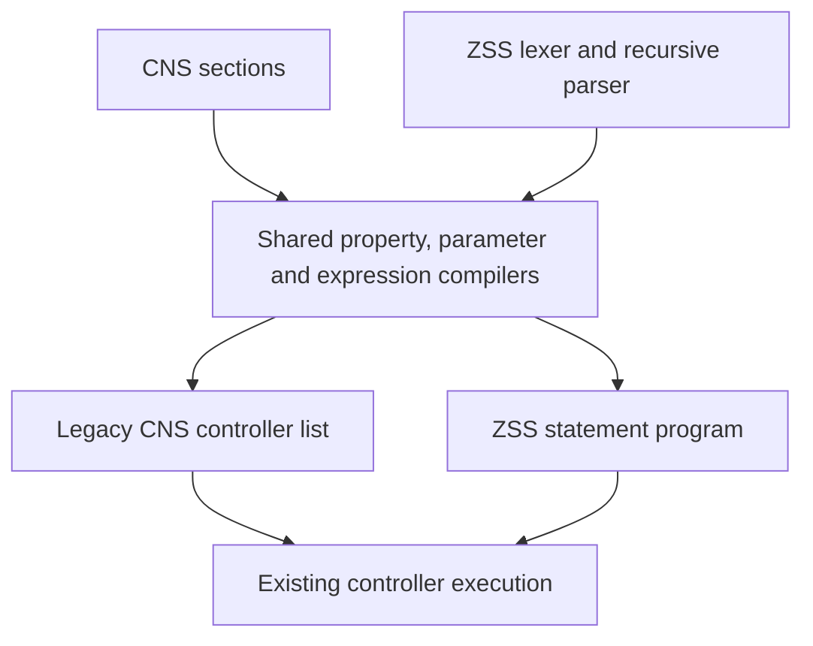

# ZSS compiler and runtime implementation plan

Status: RESEARCH / PROPOSED. No ZSS compiler or runtime has been implemented by this document.
Research date: 2026-11-16 (Asia/Jakarta).

## 1. Decision

Implement a native C ZSS front-end and a small structured statement executor.
Reuse this engine's state-property compiler, controller parameter compilers,
controller implementations, trigger implementations and expression evaluator.
Extend the shared expression infrastructure where ZSS needs locals and lazy
control flow. Keep the existing CNS front-end and execution path as the
regression reference.

Do not embed the Go engine, translate ZSS to Lua, or generate a CNS text file
as the production implementation. Those approaches either introduce another
runtime or lose state-block semantics and ownership.

The first supported dialect should be **ZSS with the MUGEN numeric/controller
profile**: ZSS control flow, numeric locals and functions over the engine's
implemented MUGEN triggers/controllers. This is not complete current Ikemen GO
character compatibility. Publish a feature manifest and fail explicitly for
unsupported facilities, including first-class strings, wide integer features,
Ikemen-only maps, triggers and controllers. Full Ikemen compatibility is a
separate, larger engine project.

## 2. Pinned evidence and scope

Engine under investigation:
[ee508ae95819c4f817919f801386424da84dbd1a](https://github.com/leonkasovan/mugen-unleashed/commit/ee508ae95819c4f817919f801386424da84dbd1a).

Upstream reference:
[Ikemen GO b55af1a13c128c16b4d4331f8f1fe67dcd4f06df](https://github.com/ikemen-engine/Ikemen-GO/commit/b55af1a13c128c16b4d4331f8f1fe67dcd4f06df)
(develop snapshot fetched on the research date). Its source, not moving line
numbers from an older checkout, is the compatibility reference.

Primary source anchors:

| Reference | Relevant code |
|---|---|
| I1 | [compiler.go:494](https://github.com/ikemen-engine/Ikemen-GO/blob/b55af1a13c128c16b4d4331f8f1fe67dcd4f06df/src/compiler.go#L494): tokenizer; scan at 7561 |
| I2 | [compiler.go:7653](https://github.com/ikemen-engine/Ikemen-GO/blob/b55af1a13c128c16b4d4331f8f1fe67dcd4f06df/src/compiler.go#L7653): statement termination, key/value reader, variable names |
| I3 | [compiler.go:7795](https://github.com/ikemen-engine/Ikemen-GO/blob/b55af1a13c128c16b4d4331f8f1fe67dcd4f06df/src/compiler.go#L7795): block attributes, if/else, switch, loops, calls, let and statements |
| I4 | [compiler.go:8395](https://github.com/ikemen-engine/Ikemen-GO/blob/b55af1a13c128c16b4d4331f8f1fe67dcd4f06df/src/compiler.go#L8395): ZSS file compiler |
| I5 | [compiler.go:5659](https://github.com/ikemen-engine/Ikemen-GO/blob/b55af1a13c128c16b4d4331f8f1fe67dcd4f06df/src/compiler.go#L5659): local reads; logical compilation at 6042/6086; expression entry at 6172 |
| I6 | [bytecode.go:4993](https://github.com/ikemen-engine/Ikemen-GO/blob/b55af1a13c128c16b4d4331f8f1fe67dcd4f06df/src/bytecode.go#L4993): function frames, call validation, block execution and loop signals |
| I7 | [bytecode.go:17006](https://github.com/ikemen-engine/Ikemen-GO/blob/b55af1a13c128c16b4d4331f8f1fe67dcd4f06df/src/bytecode.go#L17006): state program and entry/run lifecycle |
| I8 | [compiler.go:7166](https://github.com/ikemen-engine/Ikemen-GO/blob/b55af1a13c128c16b4d4331f8f1fe67dcd4f06df/src/compiler.go#L7166): file dispatch and appended .zss fallback |
| I9 | [compiler_functions.go:2323](https://github.com/ikemen-engine/Ikemen-GO/blob/b55af1a13c128c16b4d4331f8f1fe67dcd4f06df/src/compiler_functions.go#L2323): shared HitDef compiler |
| I10 | [Official ZSS wiki](https://github.com/ikemen-engine/Ikemen-GO/wiki/ZSS): author-facing introduction; source resolves discrepancies |

No native Ikemen runtime, Windows binary, Android APK or Vita VPK was built
during this research. The engine's Linux x86-64 CNS host harness and a temporary
extension of it were run; section 15 records the results.

## 3. Corrections and subtleties to preserve

The supplied architecture description is a useful starting point. These details
need correction or explicit qualification against the pinned implementation:

| Topic | Verified behavior / implementation consequence |
|---|---|
| For loop | It is a begin/end/increment range, with inclusive endpoints, not C's init/condition/update. The end and increment are evaluated at loop entry. A positive step counts upward, a negative one downward; omitted step is +1. A zero step is allowed and reaches the loop guard. |
| For declaration | Use `for i = 0; 3 { ... }`, then read `$i`. Do not implement the supplied `for let $i = ...` spelling as the reference syntax. |
| Controller termination | Use `VelSet { x: 2; y: 0; }` with no semicolon following the closing brace. Assignments, let, call, break and continue do require semicolons. Root-level `statementEnd` also imposes line-boundary rules. |
| Branch execution | A block's if condition is evaluated once per visit. Children changing values used by that condition must not cause later children to re-evaluate it. |
| Switch | The implementation constructs an ordered equality/OR if/else chain. Do not silently hoist a side-effecting header into a single temporary: that can change calls to random or assignments. No C-style fallthrough. |
| Persistence | `persistent(1)` is accepted. Values <= 0 map to the once-only sentinel. Persistence is rejected in functions and negative states. Parent persistence gates a block; it is not a fresh independent countdown attached to every leaf. |
| Hitpause | Inherited execution permission and whether an ancestor must be visited to reach an ignoring descendant are distinct. A single copied boolean is insufficient. Functions receive their permission from the call site. |
| Functions | Duplicate name in one file is an error. Across files, the first definition wins; the later definition is still parsed. Calls without result bindings can discard results; result bindings, when present, must match the callee's result count. |
| Local lifetime | Local slots belong to one state execution or function invocation, not persistent character var/fvar storage. Upstream allocates fresh frames initialized to its no-value representation; reusing a frame must clear old contents. |
| Limits | 256 slots per state/function, including arguments and returns; 2500 is the per-loop runtime guard, not a whole-tick cost bound. |
| Value model | Current upstream also supports string and extended integer facilities. This project's Expr is not the same bytecode or value representation. |
| Reuse claim | ZSS and CNS share semantics inside Ikemen. That does not make Ikemen's expressions or controllers identical to this reconstruction's MUGEN semantics. |

Tests must settle exact side-effect order, loop-control-variable values after
exit, bottom/no-value conversions and line closure behavior before claiming
source compatibility.

## 4. Existing engine: exact integration points

All following paths refer to the engine snapshot in section 2.

| File / entry | Existing behavior | Work needed |
|---|---|---|
| `src/char.c:645–823` | Separately loads command definitions, constants, primary states, st0..st9, CMD states and common states through Ini | Introduce state-source dispatch before Ini parsing; preserve constants and command-definition loading |
| `src/statedef.c:69 StateDef_Parse` | Compiles properties and discovers following CNS controller sections in one function; requires at least one controller | Extract reusable property compilation; ZSS must not manufacture dummy CNS sections |
| `src/statedef.c:316/342` | StateDefs_Load/LoadMore build/grow a KeyedArray of StateDef | Transactional ZSS state installation and a companion program registry |
| `src/sctrl.c:372 StateCtrl_ParseParams` | Shared parameter compilation and type/version checks | Feed native ZSS parameter pairs to the same implementation |
| `src/sctrl.c:1224 StateCtrl_Parse` | Adds CNS trigger1/triggerall and per-controller attributes | Keep this CNS-specific; ZSS owns condition blocks and attributes |
| `src/expr.c:696/996` | Expr_Compile and Expr_Eval use typed postfix tokens | Context-aware local references; ZSS logical jumps; strict parsing and verification |
| `src/trigger.c:500/1372` | Trigger parsing and ordered CNS trigger groups | Reuse trigger implementations; preserve original group short circuit |
| `src/sctrl.c:1352 StateCtrl_Run` | Controller execution plus state-change/AI bookkeeping | Call this shared behavior from the ZSS executor; do not bypass it with direct StateCtrl_Apply |
| `src/statedef.c:408 Player_RunState` | State entry properties, byte counters, flat controller list | Dispatch the ZSS body after shared state entry and before the empty-controller early return |
| `src/statedef.c:547 Player_RunSpecialState` | Own/custom state selection and negative-state execution | Add matching ZSS dispatch here too |
| `src/playerstate.c:34 Player_ChangeState` | Validity lookup uses StateDefs.list | Keep an ordinary StateDef entry for every ZSS state |
| `src/statedef.c:357 StateDefs_Free` | Frees controllers, expressions and the state list | Destroy the matching program registry and function objects |
| `src/char.c:1969/2125/2412` | Player create/free/reset | Own per-player persistent counters and runtime sidecars here |
| `src/playerstate.c:3105` | Precache worker loads characters | Compiler state and registry publication must have explicit ownership/thread rules |

Important constraints:

- `StateDefs`, `StateDef`, `StateCtrl`, `Expr`, `Trigger` and `Player`
  preserve original 32-bit layouts. Do not add pointer fields to them.
- `Player.sctrl_wait` is a 512-entry byte-counter array. ZSS block persistence
  needs separate int32 counters, not reused byte slots.
- A KeyedArray grow can relocate StateDef elements. Never key the new registry
  by a borrowed StateDef pointer.
- Empty or function-only ZSS files need their own valid load result. The CNS
  loaders currently reject files without states/controllers.
- Raw ZSS cannot pass through `Ini_Parse`: it discards semicolon comments, but
  semicolons are ZSS syntax.

## 5. Architecture

Keep two input paths and two body execution paths, sharing controller semantics.



The diagram describes code reuse, not a conversion from ZSS to a CNS list.
Block conditions, branch selection, loop state and function frames remain part
of the ZSS program.

Proposed modules (names are recommendations, not existing APIs):

| Module | Responsibility |
|---|---|
| `src/zss.h` | Public compile/run/free contracts and feature profile |
| `src/zss_lex.c` | Bounded source cursor, tokens and source spans |
| `src/zss_parse.c` | Recursive-descent statements, declarations and headers |
| `src/zss_program.c` | Immutable node arrays, pools, functions, verification, transactional installation |
| `src/zss_run.c` | Explicit execution stack, locals, loops and controller dispatch |
| `src/scriptparams.c/.h` | Parameter reader with CNS Ini and ZSS-pair adapters |
| `src/scriptctx.c/.h` | Explicit compile/evaluation contexts and lifecycle sidecars |
| Existing expression/trigger modules | Shared numeric expressions plus opt-in ZSS token extensions |

A program can use a contiguous node array with child/sibling/else indices,
rather than one heap allocation per node. Nodes hold expression/controller
handles, source-span indices and attribute metadata. Compiled nodes remain
immutable; loop cursors, counters and function frames are runtime data.

Initially execute the structured IR directly. A second optimizing statement
bytecode or binary cache is optional future work, after measurement.

## 6. Shared parameter compilation and strictness

Introduce a small `ScriptParamReader` contract:

- lookup a key; iterate repeated values where a CNS helper requires it;
- preserve raw value bytes, source span and consumed-key information;
- obtain its explicit compile context and language profile;
- report errors without changing unrelated global compiler settings.

Provide one adapter around the selected Ini section and another around parsed
ZSS key/value spans. Existing exported CNS signatures remain wrappers using the
legacy context. Internal shared routines gain explicit reader/context forms.

Extract the property-only part of StateDef_Parse and adapt StateCtrl_ParseParams
and its delegated compilers: HitDef, Projectile, Helper, Explod, PlaySnd, Pause,
PalFX, prefixes, vectors and formatted strings. This is a substantial shared-code
refactor, not just replacing two top-level functions.

Route recursive expression/trigger compilation through the same compile context,
including redirect arguments and expressions inside cond or controller payloads.
An outer parser mode alone does not make those nested paths strict.

For ZSS:

1. Reject duplicate keys before compilation.
2. Reject unknown controller names, unsupported profile features, missing required
   parameters and invalid version use.
3. Check consumed input: a successful prefix parse must not hide trailing junk.
4. Track unused keys and compare the acceptance rules with the upstream compiler.
5. Return a source-aware error and clean up the partial object. Do not call a
   process-aborting legacy parser error path for malformed ZSS.
6. Keep HitDef-style `attr: S, NA` and sound/animation prefixes as parameter
   syntax; not every parameter is a generic numeric expression.
7. Distinguish a block's ignorehitpause attribute from a controller parameter
   with a similar name.

Avoid serializing arbitrary ZSS values to a CNS text buffer and reparsing it.
Quoted semicolons, comment characters, multiline values and string case must
survive intact. Lowercase identifiers/keys for lookup, never string contents.

## 7. Expressions, locals and evaluation contexts

### 7.1 Shared infrastructure, different compilation policy

Retain the existing CNS parser/evaluator behavior. Add explicit context-aware
internal entry points, conceptually:

```c
/* Proposed contracts; exact declarations belong to the implementation. */
int Expr_CompileCtx(const char *text, Expr *out, ScriptCompileCtx *ctx,
                    const char **end, int want);
int Expr_EvalCtx(Player *player, const Expr *expr, ScriptEvalCtx *ctx,
                 int *int_out, float *float_out);
```

The original public functions use the CNS context. Shared controller parameter
compilers and runners must pass the ZSS context when invoked by ZSS. This
requires plumbing through nested trigger evaluation and controller-specific
helper routines, not merely passing context at a file entry point.

Do not add a process-global zssMode or current-locals pointer. Precache may compile
while the engine is active, and nested calls/custom states must restore their
contexts. Prefer explicit contexts throughout. Any temporary scoped bridge
would need separate thread isolation and unwind tests on every toolchain.

### 7.2 Minimal evaluator extension

Preserve Expr's layout and legacy token meanings. Add ZSS-only local-read tokens
carrying slot indices, and conditional jump/pop operations for lazy logical
expressions. Numeric operands use fixed-width data; jump targets are validated
indices within the expression, never pointers cast into int.

A temporary expression AST or span representation during ZSS compilation can
lower to Expr instructions with jumps. Reuse trigger compilation and numeric
operations rather than maintaining another table of trigger/controller meanings.

The verifier must understand control-flow edges: all reachable paths leave one
value, branch destinations are valid, local indices are in range, and maximum
stack use fits the declared execution budget. The existing linear postfix depth
check is insufficient for jumps.

Audit Expr_Free, Expr_Copy/Clone, scaling helpers and Trigger_Copy/Free for the
new token types and nested ownership. Tests must exercise cloning expressions
that contain locals, jumps, redirects and cond branches.

### 7.3 Semantics that need explicit tests

- ZSS `&&` and `||` lazy evaluation, value normalization and bottom handling,
  compared with the pinned upstream. CNS keeps its existing eager operands.
- Eager `ifelse` versus lazy `cond`; do not give both functions the same shortcut.
- Precedence, right/left association, intervals and redirect assignment.
- Local references inside controller parameters, HitDef payloads, cond branches
  and redirected expressions. Redirection changes the player receiving the
  trigger, not the lexical local frame.
- Constant folding only for proven pure constant subtrees. Never fold random,
  assignments, runtime triggers or unsafe mathematical operations. Preserve the
  chosen profile's numeric rounding/overflow behavior.
- Literal parsing must consume the full token and distinguish intentional
  legacy saturation from strict ZSS range errors.

### 7.4 Locals and functions

Use a separate slot count type large enough to represent 256. Valid slot
indices are 0..255; reject slot 257 before narrowing to uint8_t.

For the initial numeric profile, use explicit int32, float32 and bottom/no-value
tags. Do not treat a full native ExprValue union as a fixed four-byte value:
it contains a pointer alternative and grows on 64-bit.

Each state-body invocation gets a fresh local frame. let reassigns the same
state/function-wide slot; nested blocks do not imply C lexical shadowing.
Each function call gets a fresh frame, with arguments first, return slots next,
then temporaries. Clear reused frames. Do not allocate locals in var/fvar slots.

Strings and wide-integer values require a later tagged-value/string-pool design
and controller ABI audit; until then they receive explicit unsupported-feature
diagnostics rather than silent coercion.

## 8. Structured execution and control transfer

Represent body results as a flow enum plus existing controller-result bits.
Keep NEXT, BREAK, CONTINUE, STOP and ERROR distinct. Preserve
STATECTRL_CHANGED and STATECTRL_STOP separately when adapting StateCtrl_Run.
Do not reinterpret every nonzero return as a loop break.

Execution rules:

- An if selects its branch once and executes that branch in order.
- A nested state change or DestroySelf unwinds the old block/function/loop path
  immediately according to the existing controller bits.
- A break is consumed by the nearest enclosing loop. A continue reaches that
  loop's increment/condition phase. No global loopBreak/loopContinue flags.
- A function's frame and expression stack are restored on all exits, including
  a failed call, state change, bottom value, guard limit and allocation failure.
- Resolve functions against the owner of the active state program. A victim
  executing another character's custom state must not accidentally use its own
  function table. Preserve that owner through nested calls and redirects.
- Keep a stable active-program handle while controllers change p->states or
  p->custom_states; do not rediscover the callee owner from a modified player.
- Reset the same AI-command preparation/bookkeeping the CNS path performs.
- Share state-entry property application; do not apply it twice for ZSS.

Use an explicit bounded execution stack to avoid unbounded C recursion on Vita.
For-block counters belong to each invocation; never store running loop cursors
in immutable program nodes shared by helpers or recursive function calls.

## 9. Blocks, persistence, switch and loops

### Persistence and hitpause

Allocate int32 persistence counters per player and active state instance in a
runtime sidecar. Initialize/reset them on entry and release them on player
destruction/reset as appropriate. A same-number state reentry must reset them;
state number equality alone is not an entry test.

Reproduce the reference's countdown order, guard evaluation order and once-only
sentinel. Nested persistence creates nested gates; flattening it onto every
controller changes timing. Test persistence during hitpause and state changes.

Track both direct inherited permission and descendant visitation requirements.
A child marked ignorehitpause must still be reachable through ordinary parents
without making unrelated siblings execute during hitpause.

### Switch

Compile source-order case lists into conditional blocks using the reference's
equality/OR construction and default behavior. Preserve exact evaluation count
for random/assignment headers. Test default-before-case, duplicate default and
case separators. Defer jump-table optimization.

### Loops

Implement `for i = begin; end; increment { ... }` and `for begin; end { ... }`
as range loops. Endpoints are inclusive; begin/end/increment are entry-time
values. The loop body may modify its control variable: the next step must use
the reference behavior, not an independent hidden C counter.

Implement while as a condition checked for each iteration. Enforce the upstream
2500-iteration guard and test off-by-one behavior against the reference.

Proposed additional protections, explicitly engine extensions rather than
upstream guarantees: maximum block/call depth and a deterministic total
instruction budget shared by the entire player invocation. A per-loop guard
alone permits enormous nested work. Select the final budget from a measured
corpus; do not use elapsed wall-clock time as a gameplay abort criterion.

Define signed loop increments without C signed-overflow UB. Qualification must
decide whether the numeric profile wraps or rejects each overflow case.

## 10. Loading, ownership and atomic installation

### File dispatch

Add a state-loading helper over Stream and the character's existing resolver:

1. Resolve the explicitly requested source with existing directory/ZIP rules.
2. Select ZSS only by the final .zss extension (case policy tested).
3. On a missing non-ZSS state source, optionally try the appended .zss filename
   in the same resolution order.
4. Never substitute a fallback because a present CNS file has a syntax error.
   The proposed missing-only policy is deliberately narrower than upstream's
   generic load-error fallback and must be documented.
5. Parse ZSS directly from its owned source buffer, before Ini_Parse.
6. Support st, st0..st9, CMD state portions and stcommon. Leave character
   constants and command definitions on their established CNS/INI paths.

The current loader reads a CMD twice for different purposes. A .cmd.zss fallback
can replace its state portion; it cannot supply missing [Command] definitions.
Likewise, a ZSS state file cannot replace the constants file's [Data]/[Size]/etc.
The first milestone should use an explicit stN = file.zss entry and retain
ordinary cns/cmd resources.

Function-only files must successfully append function definitions even if they
add zero states. Maintain deterministic file order.

### Duplicate and merge policies

- Same-file duplicate ZSS states/functions: hard error.
- Across-file functions: first definition wins, but parse/check the later body.
- Preserve existing CNS collision handling for all-CNS characters.
- For mixed files, specify and test positive-state precedence and negative-state
  composition. Upstream's ZSS branch accumulates existing negative state bodies.
  Do not change the legacy list's duplicate keys as an incidental parser change.
- Map any composition into the sidecar's effective program explicitly. If an
  initial milestone does not support a collision pattern, reject it clearly.
- Reject unsupported special states, such as current upstream's +1 extension,
  until their scheduling semantics exist in the engine.

### Ownership model

Use a registry keyed by (owning StateDefs*, state number) with stable generation
or program handles. Function tables belong to the same owning state collection,
not to a single source file or a currently redirected player.

Parse one file into temporary owned program/controller/expression storage.
Validate and reserve destination capacity before publishing anything. On
failure, release all partial objects and retain previously loaded state tables.
Avoid pointers into a growable KeyedArray or temporary token/source buffer.

Source spans refer to retained filenames/line maps, not a borrowed ZIP entry:
the loader can unload or close its Stream after compilation. Retain source text
only when diagnostics/debugging needs it; runtime requires owned values/IR.

Character unloading destroys program metadata; player/helper unloading destroys
runtime frames/counters. Synchronize compile/publication/free with precache
ownership. Do not insert an unsynchronized reallocating global sidecar table.
Existing Expr parsing also has a process-static recursion-depth counter, so
concurrency must be audited or compilation serialized explicitly during the
context migration.

## 11. ABI and platform design

| Target | ABI issue / qualification |
|---|---|
| Windows x86 | ILP32 reference; all original layout assertions must still pass |
| Windows x64 | LLP64: pointers are 64-bit while long remains 32-bit; no pointer packing |
| Linux x86-64 / arm64 | LP64: long and pointers are 64-bit; use explicit integer-literal and slot arithmetic |
| Android | Current package is arm64-v8a only; test NDK compilation plus actual APK execution; do not claim armeabi-v7a coverage |
| PS Vita | ARM32; constrained RAM/stack and alignment; test VitaSDK build and on-device execution |

Rules:

- Keep legacy layout assertions active as appropriate. Add separate asserts for
  new fixed-width values and offsets; do not disable checks to accommodate ZSS.
- Use sizeof for pointer-bearing allocations/copies, checked size_t arithmetic
  for arenas and uint32/int32 handles for logical indices.
- Do not memcpy a native Expr, Trigger, StateCtrl or pointer table into a
  platform-independent byte stream.
- No binary cache in the first release. A later one needs a version, explicit
  endian/width encoding, feature profile, semantic compiler version, source
  hashes and relocation-free indices.
- Preserve this project's Ftol/Trunc64 and numeric policy. Ikemen's Go numeric
  behavior is not automatically the reconstruction's numeric reference.
- ZSS itself requires no SDL/GL/VitaGL calls or extra runtime dependencies.
- New compilation units are discovered by the root Makefile and Android/Vita
  CMake globs. Add explicit tests, includes and option propagation as needed;
  root MSVC/CMake remains retired.
- If MUGEN_ZSS is a build gate, include it in the root configuration stamp and
  the Android/Vita CMake/build.bat options. Disabled builds must reject a .zss
  resource explicitly, not parse it as CNS.

Do not modify mugen.cfg display dimensions or renderer settings for this work.

## 12. Incremental implementation and acceptance gates

| Phase | Deliverable | Required evidence before proceeding |
|---|---|---|
| Z0: freeze contract | Pinned grammar, numeric feature manifest, duplicate/load policies and reference fixtures | For syntax, controller termination, side effects, loop ranges, locals, hitpause and persistence have explicit expected outcomes |
| Z1: shared compiler seams | Parameter reader and explicit compile/eval contexts; extracted state-property compiler; cleanup ownership | Existing CNS ABI suite and representative game traces unchanged; allocation-failure tests pass |
| Z2: first usable file | Lexer, StateDef/controller parsing, source errors, explicit stN .zss dispatch; simple sequence executor | Synthetic ZSS character executes Pos/Vel/ChangeAnim/ChangeState through existing controllers; state entry and negative-state dispatch covered |
| Z3: expressions and branches | Numeric locals, ZSS logical jumps, if/else, assignment statements, verifier | Side-effect/evaluation-order fixtures match the chosen reference profile; no changes to CNS eager behavior |
| Z4: complete block control | Attributes, switch, for/while, break/continue, per-player counters | Persistence/hitpause traces, loop boundaries/guards, state-change unwinding and two-helper isolation pass |
| Z5: functions | Argument/return slots, first-wins table, forward calls and runtime validation | Nested calls, discarded returns, mismatch no-op, custom-state ownership and recursion limits pass |
| Z6: loader and lifecycle completion | Missing-file fallback, function-only files, ZIP sources, mixed-file composition, reset/unload/precache | No missing commands/constants; failed file loads are atomic; no registry/frame leaks or pointer-reuse errors |
| Z7: platform rollout | Build gate propagation, diagnostics, profiling, supported syntax examples and documentation | Native build matrix plus required device rows; explicit OPEN gaps instead of host-mock device claims |

Z2 is a prototype subset, not a release claiming full ZSS. Z3–Z6 complete the
planned numeric language profile. Keep the feature opt-in until Z7's gates pass.
Do not start by converting all common states or requiring users to rewrite
their existing characters.

Suggested first synthetic input:

```text
[StateDef 200; type: S; movetype: A; physics: N;]
if time = 0 {
    ChangeAnim { value: 200; }
    VelSet { x: 0; y: 0; }
}
if animtime = 0 {
    ChangeState { value: 0; ctrl: 1; }
}
```

Add locals/for/functions only in later fixtures. Use supported numeric parameters
rather than copying an upstream system script containing maps or other missing
engine features.

## 13. Test plan

### Front-end and errors

Token spans and diagnostics for CRLF/LF, optional BOM, comments, case, quoted
delimiter characters, multiline headers, root versus nested terminators,
helper-controller versus helper redirect, intervals, malformed strings/braces,
trailing tokens and unknown parameters.

Check same-file duplicates, function-only sources, cross-file order, 256 versus
257 slots, slot 255 and large/signed state numbers. Bound every source, token,
expression and nesting allocation. Inject allocation failure at each compile
stage and verify zero partial publication and no leaked controllers/expressions.

### Expressions and semantic differential tests

Use three distinct comparisons:

1. Existing CNS build versus candidate CNS path: original behavior must remain.
2. CNS versus equivalent ZSS for the common supported numeric/controller subset.
3. Candidate ZSS versus the pinned Ikemen behavior for isolated language cases
   with matching available builtins.

A flat CNS rewrite is not a valid oracle for nested if semantics. For example,
`if var(0) = 0 { var(0) := 1; var(1) := 2; }` must execute both assignments.
Converting both leaves to independent trigger checks changes the second result.

Test assignments inside false && / true || operands, eager ifelse, lazy cond,
bottom values, integer limits, floats, random-consumption order and redirect
local reads. Match the reference only where the declared profile promises it.

### Runtime and lifecycle

Record ordered controller IDs, local tags/values, state changes and per-tick
persistence counters. Include nested loops, positive/negative/zero steps,
initially empty ranges, end-boundary inclusivity, body-modified loop variables,
break/continue and calls that change state or destroy the helper.

Run multiple helpers sharing one character program, two players in the same
state number, custom states from another owner, same-number reentry, reload,
round reset, player-pointer reuse, failed loads and precache cancellation.

Undefined function or arity mismatch must warn and no-op as specified, with no
argument side effects if validation precedes argument evaluation. A call that
ignores returned values is valid. Measure and bound warning repetition without
silently changing call behavior.

### Platform / tooling

Extend tools/test_cns_abi.sh; add headless test_zss_parse, test_zss_expr,
test_zss_run and test_zss_load harnesses. Put scripts into qualification/CI with
explicit ABI assertions and sanitizer variants. Real compiler/VM paths must be
linked; do not stub away the expression/controller feature being asserted.

Require Windows x86/x64, Linux x64/arm64 and Android arm64 native compilation.
VitaSDK compilation and actual Vita runs are separate rows. Runtime device
qualification must include hitpause, custom states, functions, loops and cleanup,
not just reaching the title screen. Missing toolchains/devices remain OPEN.

Game verification: deterministic fixed-seed CNS baseline logs, a small converted
test character, state/variable traces and repeatable gameplay inputs. Screenshot
or mugen.log equality alone cannot prove compiler semantics. Do not change
display size to facilitate testing.

## 14. Memory and performance plan

Compile at character load/precache time, never parse source while running a
state. Use owned arenas for tokens/IR and pooled runtime frames. Free the AST
after lowering; retain only necessary diagnostics. Avoid persistent full-size
256-slot arrays on every inactive helper.

Report compile time, peak compile heap, retained program bytes, expression
instructions, nodes/controllers, maximum local/call depth, loop iterations,
controller execution count and steady runtime allocations. Add a symbol/state
name to expensive-script diagnostics.

Keep the state-program registry out of per-controller hot lookups: resolve once
per state-body invocation. Cache function handles only within the owning program
generation. Use the existing memory profiler; no dependency is needed.

Arithmetic example, not a measured memory result: if numeric slots occupy eight
bytes, 256 slots cost 2 KiB per frame, and 64 fully populated call frames cost
128 KiB before IR/controller storage. This is why Vita needs explicit frame and
call-depth budgeting, not an unbounded C call stack.

Benchmark CNS versus the supported ZSS equivalents with fixed tick counts and
identical inputs; also report worst-case loops and first-use allocations. Make
performance changes only after semantic gates pass.

## 15. Research verification actually performed

On Linux x86-64, a temporary copy of tools/test_cns_abi.c was compiled with the
same production expression, trigger, controller and state units as its runner.
Only the existing test boundaries for INI/player output/variable triggers were
used. The memory-profiler wrappers were disabled for the standalone harness.

Observed:

```text
abi: 64-bit build
probe: false && assignment leaves var(0)=9
probe: 1+2 compiled token count=3 (constant marker=-1)
ok: CNS ABI regressions passed
```

Thus this engine currently evaluates that assignment despite a false left
operand, and does not fold the 1+2 example into its constant marker. These are
implementation facts, not recommendations to change CNS.

The upstream Go sources and license were fetched at the pinned revision and
inspected. No full upstream parser/runtime was executed. Exact compatibility
fixtures in Z0 are still required. No ZSS implementation, APK/VPK, performance
savings or native device qualification is claimed.

## 16. Risks and decisions to settle first

| Risk | Mitigation / decision |
|---|---|
| Calling syntax support “Ikemen compatibility” | Name and version the numeric/controller profile; list unsupported builtins and value types |
| Changing existing CNS while adding lazy expressions | Preserve legacy wrappers and token behavior; test old and new paths separately |
| Incomplete context propagation | Audit every delegated parameter parser, nested trigger and runtime expression call |
| Shared state pointers invalid after growth | Registry keyed by stable owning collection/number and generation handles |
| Mutable counters in compiled blocks | Per-player state-instance counters and per-invocation loop/frame data |
| Hitpause/persistence drift | Ordered tick traces against pinned upstream and equivalent CNS where applicable |
| Wrong function owner in custom states | Resolve from active program ownership, not redirected player data |
| Unbounded nested work on Vita | Loop guard plus explicitly documented call/block/total-work limits |
| Partial loads or failed compile leaks | Temporary ownership, reserve-before-commit, allocation-failure tests |
| Precache/global parser races | Explicit contexts, audited publication/free, serialization until reentrancy is proven |
| Copying Go implementation introduces dependencies | Reimplement in C using existing infrastructure; no Go runtime or new library |
| Source adaptation attribution | Preserve the pinned Ikemen MIT copyright/permission notice for copied or translated implementation portions, with provenance recorded |

Recommended first implementation task: Z0 and Z1, followed by the explicit
stN-based Z2 prototype. The main engineering cost is safe shared compiler/runtime
integration, not recognizing braces and keywords.


## 17. Implementation progress

2026-11-16: the allocation-free native C lexer is implemented in
`src/zss_lex.c/.h`, with regression coverage in `tools/test_zss_lex.c/.sh`.
It retains raw length-delimited source spans and tracks lines/columns, including
BOM and CRLF handling. Comments, numeric exponents, operators, locals, string
delimiters, token bounds and sticky errors are covered. The caller owns source
lifetime and selects a token-size bound. This is the lexical portion of Z2;
Z1 compiler-context/parameter interfaces and the remaining parser/runtime work
are still pending. No .zss file is dispatched or executed yet.

Verification: Linux x86-64 warning-clean lexer tests; ASan/UBSan with leak
detection disabled because LeakSanitizer cannot run under this environment's
ptrace; Android-preprocessor host variant; existing CNS ABI regression suite.
The Android variant is not an NDK build or a device pass. No native Windows
or Vita toolchain qualification was performed.

### Controller bridge increment

The next increment adds `scriptparams.c/.h` and `zss_controller.c/.h`.
`Zss_CompileController` parses one standalone controller, then invokes the
existing `StateCtrl_ParseParams`; it publishes an owned StateCtrl only after
success. The native parameter adapter creates a normal owned Ini directly,
without calling Ini_Parse or stripping quoted semicolons. Keys are canonicalized
without mutating global INI case settings. Source-line mappings are retained.

Enabled prototype controllers: VelSet, VelAdd, PosSet, PosAdd, CtrlSet,
ChangeState, ChangeAnim, Turn, Null, DisplayToClipboard, AppendToClipboard and
ClearClipboard. Each has an explicit accepted-key schema. Complex payload
controllers remain rejected until their partial-parse ownership is audited.

This increment uses existing MUGEN expression semantics. Explicit expression
contexts, ZSS short circuit, locals, block/file parsing, loader dispatch and
execution are still pending; it does not enable .zss characters. Current bounds
are 1 MiB per standalone source, 128 user parameters and 63 tokens per parameter;
these prototype limits must be revisited against the reference corpus.

Tests: `sh tools/test_zss_controller.sh` links the real INI, controller,
expression and trigger parsing implementations in the existing CNS host harness.
It checks numeric expressions, var references, literal delimiters/case, duplicate
and unknown keys, malformed input, unchanged output on failure, and allocation
failure cleanup. Shared controller subsystems outside the enabled subset retain
the harness's existing explicit stubs. Linux CI now runs CNS, lexer and controller
bridge gates. Native Windows/Android/Vita qualification remains OPEN.

### StateDef header increment

Added `Zss_CompileStateHeader` in `zss_statedef.c/.h`. It parses one header,
checks the signed 32-bit state number, rejects duplicate/unknown properties and
invalid literal type letters, and invokes the shared property compiler.
`StateDef_CompileProperties` and `StateDef_FreeProperties` were extracted from
`statedef.c`; CNS now uses the same routines with its original defaults, negative
state behavior and numeric semantics. Original structure layouts are unchanged.

`zss_params.c/.h` factors the controller parameter scanner into a reader also
used by state headers. It distinguishes the header closing bracket from brackets
inside interval expressions. Output owns only properties; no controller list is
created and the header cannot yet be installed into a StateDefs collection.
Both the output header and state number are unchanged on compile failure.

The existing bridge gate now checks header defaults, compound/variable/vector
properties, intervals, signed integer boundaries, malformed headers, partial
compilation cleanup and injected allocation failures. File bodies, expression
contexts, locals, block execution and file dispatch remain pending.

The sanitizer test of an empty header exposed a missing sentinel pointer in the
native parameter adapter. The adapter now reserves and initializes that pointer
for empty groups; the empty-header regression exercises the real INI path.

### Owned state-program and body increment

`zss_program.c/.h` now compiles a bounded in-memory source into an owned opaque
program: multiple StateDefs, the enabled leaf controllers, and nested
if/else-if/else bodies. Duplicate states, unsupported statements and malformed
bodies fail without publishing partial output. Compiled expressions, controller
payloads and properties survive release of the source. Arena growth uses stable
indices and allocate/copy/publish ownership. Prototype limits are 64 states, 1024
nodes, 32 block levels and 1 MiB source; root statements require line boundaries.

An isolated explicit-stack body executor evaluates a guard once per visit and
dispatches selected leaves through a callback carrying original STATECTRL bits.
State-change/stop results unwind the old body immediately. Guards use real
MUGEN expression evaluation, including float truth values. The production
callback must eventually call StateCtrl_Run and provide state-entry, AI and
hitpause bookkeeping; those engine hooks are not installed by this increment.

Program compilation explicitly rejects locals and &&/|| in expressions rather
than silently promising ZSS short circuit using the current eager CNS evaluator.
Loops, functions, attributes and assignment statements are not enabled.
The compiler does not yet resolve .zss files or install programs into StateDefs.

The host bridge gate also tests program ownership, duplicate/malformed states,
else selection, one-time guard evaluation after side effects, float conditions,
stop propagation, empty bodies, arena growth, nesting limits and allocation
failure cleanup. Runtime tests inject a recording controller-dispatch boundary;
they do not claim end-to-end gameplay/controller execution or native device
qualification.

### Experimental engine integration

Explicit additional sources in character DEF `st0` through `st9` entries now
dispatch `.zss` files before INI parsing. The primary st/cns source, command
definitions and common-state loader retain their existing paths. There is no
automatic .cns.zss fallback yet. Use unused state numbers: collisions are rejected
both when installing ZSS and when subsequently loading CNS into a bound state.

Installation builds a replacement keyed array transactionally. A private
SCTRL_ZSS_BODY controller owns a reference to the program and dispatches leaves
through StateCtrl_Run, preserving the existing state entry, controller result,
hitpause and negative-state loops. Original structures and their layout checks
are unchanged. Installed headers borrow immutable property expressions from the
retained program; StateDefs_Free releases bindings rather than double-freeing
those expressions. There is no process-global program registry. Install/free
operations follow the existing character/StateDefs ownership lifecycle and must
not run concurrently on the same collection/program.

The outer state loop resets command hints; guarded leaves preserve those hints
for the existing AI state-change bookkeeping. Detailed AI/custom-state behavior
and concurrent precache qualification remain OPEN. No new attributes, locals,
loops, functions or lazy expression semantics are enabled by this integration.

For diagnostics, MUGEN_ZSS_TRACE=1 at load time enables at most four body-result
log entries per installed state binding. Default logs remain unchanged.

Example DEF entry (keep ordinary cns, st, cmd and stcommon resources):

```text
st9 = experimental.zss
```

Example extra state file, entered via an ordinary CNS ChangeState controller:

```text
[StateDef 65000; type:S; movetype:I; physics:N; ctrl:0;]
if time=0 { ChangeState{value:65001;ctrl:0} }
[StateDef 65001; type:S; movetype:I; physics:S;]
CtrlSet{value:1}
```

Validation on Linux x86-64: the full native engine linked with MUGEN_MODEL3D=0,
using the existing SDL2 dependency set. A missing private glib development header
package was extracted into the disposable test subtree; no project dependency
was added. An offscreen System-renderer KFM smoke test used a copied installation
and explicit st9 file. The log recorded:

```text
Loading cns zss-smoke.zss...OK
ZSS state 65000 body result 5
ZSS state 65001 body result 0
```

Result 5 contains the existing stop/state-change bits and confirms native leaf
dispatch and transition into the second ZSS state. The run was bounded by a
12-second timeout (exit 124); the engine logged cleanup and successful termination
after the termination signal. It was not a completed match or a determinism
comparison. Original install files and display dimensions were not changed.

Host tests cover atomic installation, existing-state preservation, collision
rejection, retained references, collection destruction, memory Stream loading
and allocation-failure rollback. Their Stream reader is an explicit I/O boundary;
the native smoke run exercised the real file/Stream path. Native Windows,
Android, Vita, ZIP characters, complete gameplay and unsupported language
features remain unqualified.
