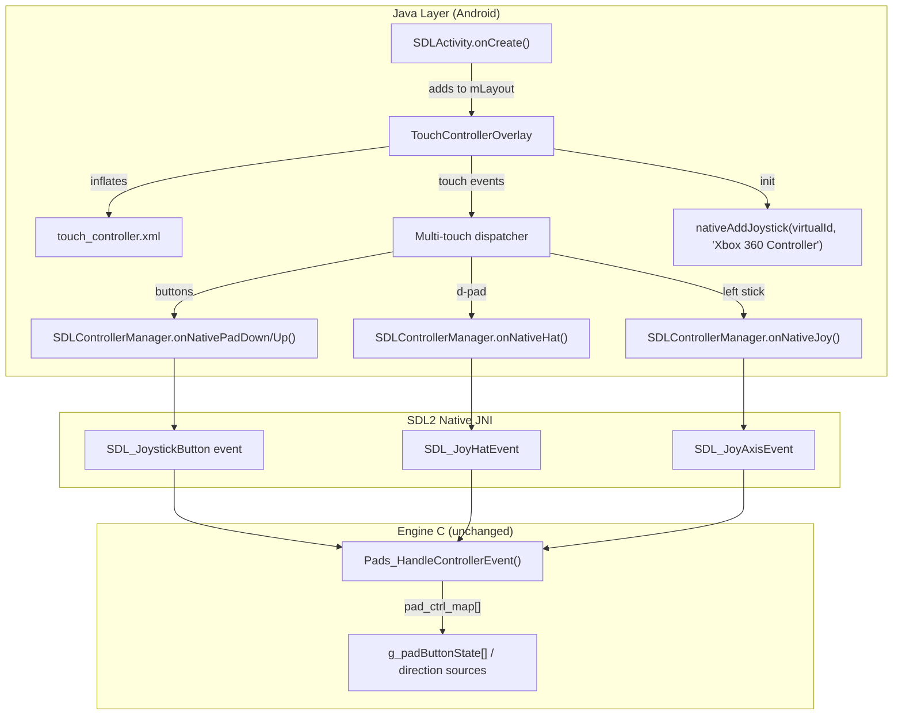

# Virtual Controller for Android

## Goal

Add an on-screen touch controller overlay to the mugen-unleashed Android port, enabling touch-only gameplay on phones/tablets without a physical gamepad. The design is informed by `ikemen-droid-pro`'s `ControllerOverlay` architecture but adapted to mugen-unleashed's existing SDL2 joystick/controller input pipeline.

## Background

The mugen-unleashed Android port currently **requires a physical gamepad** — `PLAN.md` §5.1 explicitly states "Touch-only play is not implemented." The engine processes controllers through SDL2's `SDL_GameController` API, mapping semantic buttons (A/B/X/Y/shoulders/d-pad/Start) to 11 compact engine codes (`PAD_CTRL_UP` 1 through `PAD_CTRL_START` 11, plus `PAD_CTRL_SELECT`). These flow through `pads.c`'s `Pads_HandleControllerEvent`, which writes `g_padButtonState[]` and the direction-source bookkeeping.

**ikemen-droid-pro's approach** (what we're adapting from):
- `ControllerOverlay.java` — a `RelativeLayout` inflated from `virtual_controller.xml`, intercepts all touch, dispatches to buttons/d-pad/joysticks
- `JoystickOverlay.java` — a custom `View` for analog sticks, calls `SDLControllerManager.onNativeJoy()`
- Registers a **virtual joystick** via `SDLControllerManager.nativeAddJoystick()` with Xbox 360 identity, then sends `onNativePadDown/Up`, `onNativeHat`, `onNativeJoy` for all touch inputs
- `DynamicGamepadView.java` — a heavier alternative using `onNativeKeyDown/Up` (keyboard path), with skinning, layout editing, cloud gaming, etc.

**Our approach**: Use the `ControllerOverlay` + `JoystickOverlay` pattern (the cleaner one). It injects input as a **virtual SDL joystick**, which the engine's existing `MUGEN_GAMEPAD_POLICY` controller pipeline handles — the same path a physical Xbox pad uses. No engine C code changes are required.

## User Review Required

> [!IMPORTANT]
> **Input injection path**: The overlay registers a virtual joystick via `nativeAddJoystick()` and sends `onNativePadDown/Up` + `onNativeHat`. This is the **same path** ikemen-droid-pro's `ControllerOverlay` uses. The engine's `Pads_HandleControllerEvent` in `pads.c` already handles these SDL events, mapping them to `PAD_CTRL_*` codes. The virtual device presents as a standard controller, so it respects `[P1 Gamepad]` bindings in `mugen.cfg`. **No changes to any engine C source are needed.**

> [!IMPORTANT]
> **Auto-hide when physical pad connected**: The overlay counts physical gamepads and hides itself when one is attached. This prevents the overlay from consuming touch events that would interfere with physical pad input. The overlay reappears when the physical pad is disconnected.

> [!WARNING]
> **Button codes**: ikemen-droid-pro's `ControllerOverlay` sends raw Android `KeyEvent.KEYCODE_BUTTON_*` values (96=A, 97=B, 99=X, 100=Y, 102=L1, 103=R1, 108=START, 109=SELECT) via `onNativePadDown/Up`. These are the same codes SDL2's Android JNI joystick handler uses when it receives physical button events. The engine's SDL2 layer maps these to `SDL_CONTROLLERBUTTONDOWN/UP` events, which `pads.c` then translates through `pad_ctrl_map[]`. This path is already exercised by every physical gamepad on Android.

## Open Questions

> [!IMPORTANT]
> **Analog sticks**: The ikemen-droid-pro layout includes dual analog sticks. M.U.G.E.N 1.1 does not use the right stick for anything. The left stick is functional (it steers via axis→direction in `Pads_HandleControllerEvent`). **Should we include the left analog stick in addition to the d-pad, or d-pad only?** includes the left stick; the right stick is omitted.

> [!IMPORTANT]
> **Trigger buttons (W/C)**: ikemen-droid-pro maps two extra buttons to L2/R2 triggers (codes 4004/4005). The mugen-unleashed engine does not bind L2/R2 triggers to any game action — the `pad_ctrl_map[]` table has no entry for `SDL_CONTROLLER_AXIS_TRIGGERLEFT/RIGHT`. **Should we include these trigger buttons, or keep the layout to the 6 attack buttons + d-pad + Start + Select that the engine actually uses?** omits triggers.

## Proposed Changes

### Architecture



---

### Component: Android Resources

#### [NEW] `port/android/app/src/main/res/drawable/vctrl_button.xml`

Oval button drawable with pressed/default states. Adapted from ikemen-droid-pro's `round_button.xml`:

```xml
<?xml version="1.0" encoding="utf-8"?>
<selector xmlns:android="http://schemas.android.com/apk/res/android">
    <item android:state_pressed="true">
        <shape android:shape="oval">
            <solid android:color="#AA444444" />
            <stroke android:width="2dp" android:color="#CCFFFFFF" />
        </shape>
    </item>
    <item>
        <shape android:shape="oval">
            <solid android:color="#66888888" />
            <stroke android:width="2dp" android:color="#88FFFFFF" />
        </shape>
    </item>
</selector>
```

#### [NEW] `port/android/app/src/main/res/drawable/vctrl_dpad_bg.xml`

Circular background for the d-pad container:

```xml
<?xml version="1.0" encoding="utf-8"?>
<shape xmlns:android="http://schemas.android.com/apk/res/android"
    android:shape="oval">
    <solid android:color="#44FFFFFF" />
</shape>
```

#### [NEW] `port/android/app/src/main/res/values/attrs.xml`

Declares custom XML attributes for `AnalogStickView`:

```xml
<?xml version="1.0" encoding="utf-8"?>
<resources>
    <declare-styleable name="AnalogStickView">
        <attr name="axisX" format="integer" />
        <attr name="axisY" format="integer" />
    </declare-styleable>
</resources>
```

#### [NEW] `port/android/app/src/main/res/layout/touch_controller.xml`

The layout for the on-screen controller. Landscape-oriented, with:
- **Left side**: D-pad (150dp circle with 4 directional zones)
- **Left-center**: Left analog stick (125dp)
- **Right side**: 6 attack buttons in a 3×2 arc (A/B/X/Y + C(RB)/Z(LB)), matching M.U.G.E.N's 6-button fighting layout
- **Bottom-center**: Start + Menu (Select) buttons

```xml
<?xml version="1.0" encoding="utf-8"?>
<RelativeLayout xmlns:android="http://schemas.android.com/apk/res/android"
    xmlns:app="http://schemas.android.com/apk/res-auto"
    android:layout_width="match_parent"
    android:layout_height="match_parent"
    android:splitMotionEvents="true">

    <!-- D-Pad: circular zone, angle-based 8-way detection -->
    <RelativeLayout
        android:id="@+id/vctrl_dpad"
        android:layout_width="150dp"
        android:layout_height="150dp"
        android:layout_alignParentBottom="true"
        android:layout_alignParentLeft="true"
        android:layout_marginLeft="40dp"
        android:layout_marginBottom="50dp"
        android:background="@drawable/vctrl_dpad_bg"
        android:splitMotionEvents="true">

        <Button android:id="@+id/vctrl_dp_up" android:text="↑"
            android:layout_width="50dp" android:layout_height="50dp"
            android:layout_centerHorizontal="true"
            android:layout_alignParentTop="true"
            android:alpha="0.5" android:background="#00000000" />
        <Button android:id="@+id/vctrl_dp_left" android:text="←"
            android:layout_width="50dp" android:layout_height="50dp"
            android:layout_centerVertical="true"
            android:layout_alignParentLeft="true"
            android:alpha="0.5" android:background="#00000000" />
        <Button android:id="@+id/vctrl_dp_down" android:text="↓"
            android:layout_width="50dp" android:layout_height="50dp"
            android:layout_centerHorizontal="true"
            android:layout_alignParentBottom="true"
            android:alpha="0.5" android:background="#00000000" />
        <Button android:id="@+id/vctrl_dp_right" android:text="→"
            android:layout_width="50dp" android:layout_height="50dp"
            android:layout_centerVertical="true"
            android:layout_alignParentRight="true"
            android:alpha="0.5" android:background="#00000000" />
    </RelativeLayout>

    <!-- Left analog stick -->
    <org.libsdl.app.AnalogStickView
        android:id="@+id/vctrl_left_stick"
        android:layout_width="125dp"
        android:layout_height="125dp"
        android:layout_toRightOf="@id/vctrl_dpad"
        android:layout_alignTop="@id/vctrl_dpad"
        android:layout_marginLeft="30dp"
        app:axisX="0" app:axisY="1" />

    <!-- 6-button attack grid (3 cols × 2 rows, arc layout) -->
    <RelativeLayout
        android:id="@+id/vctrl_buttons"
        android:layout_width="280dp"
        android:layout_height="200dp"
        android:layout_alignParentRight="true"
        android:layout_alignParentBottom="true"
        android:layout_marginRight="15dp"
        android:layout_marginBottom="50dp"
        android:splitMotionEvents="true">

        <!-- Top row: Y, Z(LB), --- staggered arc -->
        <Button android:id="@+id/vctrl_btn_z" android:text="Z"
            android:layout_width="55dp" android:layout_height="55dp"
            android:layout_alignParentRight="true"
            android:layout_alignParentTop="true"
            android:background="@drawable/vctrl_button" />
        <Button android:id="@+id/vctrl_btn_y" android:text="Y"
            android:layout_width="55dp" android:layout_height="55dp"
            android:layout_toLeftOf="@id/vctrl_btn_z"
            android:layout_marginTop="20dp" android:layout_marginRight="4dp"
            android:background="@drawable/vctrl_button" />
        <Button android:id="@+id/vctrl_btn_x" android:text="X"
            android:layout_width="55dp" android:layout_height="55dp"
            android:layout_toLeftOf="@id/vctrl_btn_y"
            android:layout_marginTop="40dp" android:layout_marginRight="4dp"
            android:background="@drawable/vctrl_button" />

        <!-- Bottom row: A, B, C(RB) -->
        <Button android:id="@+id/vctrl_btn_c" android:text="C"
            android:layout_width="55dp" android:layout_height="55dp"
            android:layout_alignParentRight="true"
            android:layout_below="@id/vctrl_btn_z"
            android:layout_marginTop="10dp"
            android:background="@drawable/vctrl_button" />
        <Button android:id="@+id/vctrl_btn_b" android:text="B"
            android:layout_width="55dp" android:layout_height="55dp"
            android:layout_toLeftOf="@id/vctrl_btn_c"
            android:layout_alignTop="@id/vctrl_btn_c"
            android:layout_marginTop="20dp" android:layout_marginRight="4dp"
            android:background="@drawable/vctrl_button" />
        <Button android:id="@+id/vctrl_btn_a" android:text="A"
            android:layout_width="55dp" android:layout_height="55dp"
            android:layout_toLeftOf="@id/vctrl_btn_b"
            android:layout_alignTop="@id/vctrl_btn_b"
            android:layout_marginTop="20dp" android:layout_marginRight="4dp"
            android:background="@drawable/vctrl_button" />
    </RelativeLayout>

    <!-- Start + Menu buttons, bottom center -->
    <LinearLayout
        android:layout_width="wrap_content"
        android:layout_height="wrap_content"
        android:layout_centerHorizontal="true"
        android:layout_alignParentBottom="true"
        android:layout_marginBottom="15dp"
        android:splitMotionEvents="true">
        <Button android:id="@+id/vctrl_btn_select" android:text="Menu"
            android:layout_width="55dp" android:layout_height="45dp"
            android:background="@drawable/vctrl_button"
            android:layout_margin="5dp" />
        <Button android:id="@+id/vctrl_btn_start" android:text="Start"
            android:layout_width="55dp" android:layout_height="45dp"
            android:background="@drawable/vctrl_button"
            android:layout_margin="5dp" />
    </LinearLayout>
</RelativeLayout>
```

---

### Component: Java — Touch Controller Classes

#### [NEW] `port/android/app/src/main/java/org/libsdl/app/AnalogStickView.java`

Adapted from ikemen-droid-pro's `JoystickOverlay.java`. A custom `View` that:
- Draws a translucent circle (base) with a movable stick head
- Exposes `updateVisualPos(x, y)` for the parent to position the knob
- Exposes `sendToSDL(normX, normY)` to call `SDLControllerManager.onNativeJoy()`
- Reads `axisX`/`axisY` from XML attributes via `AnalogStickView` styleable

This is essentially the same as `JoystickOverlay.java` but renamed to avoid collisions and uses our `R` package.

#### [NEW] `port/android/app/src/main/java/org/libsdl/app/TouchControllerOverlay.java`

The main overlay, adapted from ikemen-droid-pro's `ControllerOverlay.java`. Key design:

**Initialization:**
1. Count physical gamepads (using ikemen-droid-pro's `isRealGamepad()` filter — checks for `SOURCE_JOYSTICK|SOURCE_GAMEPAD` and verifies the device has actual `KEYCODE_BUTTON_*` keys to filter out ghost sensors)
2. Register a virtual joystick with `nativeAddJoystick(virtualDeviceId, "Virtual Controller", ...)` using an ID one past the highest physical device
3. Configure the `AnalogStickView` with the virtual device ID

**Touch dispatching** (multi-touch, identical to `ControllerOverlay`):
- `onInterceptTouchEvent()` → returns `true` to capture all touches
- `onTouchEvent()`:
  - `ACTION_DOWN/POINTER_DOWN`: check if touch hits analog stick → track pointer ID; otherwise find buttons at location
  - `ACTION_MOVE`: for each pointer, update either stick position or button state
  - `ACTION_UP/POINTER_UP/CANCEL`: release stick or buttons for that pointer
- D-pad uses angle-based 8-way detection with wider diagonals (30° cardinals, 60° diagonals) and 20% center deadzone

**Button → SDL mapping** (the codes that `onNativePadDown/Up` receives):

| Button | Android `KEYCODE_BUTTON_*` | Engine path |
|--------|---------------------------|-------------|
| A | 96 (`BUTTON_A`) | → SDL `CONTROLLERBUTTONDOWN` → `pad_ctrl_map[A]` → `PAD_CTRL_A` (5) |
| B | 97 (`BUTTON_B`) | → `PAD_CTRL_B` (6) |
| X | 99 (`BUTTON_X`) | → `PAD_CTRL_X` (8) |
| Y | 100 (`BUTTON_Y`) | → `PAD_CTRL_Y` (9) |
| C (RB) | 103 (`BUTTON_R1`) | → `PAD_CTRL_C` (7) |
| Z (LB) | 102 (`BUTTON_L1`) | → `PAD_CTRL_Z` (10) |
| Start | 108 (`BUTTON_START`) | → `PAD_CTRL_START` (11) |
| Select | 109 (`BUTTON_SELECT`) | → `PAD_CTRL_SELECT` → pause |
| D-pad | via `onNativeHat(id, 0, hatX, hatY)` | → `Pads_SetDirectionSource` |

**Auto-hide:** The overlay hides itself when a physical gamepad is detected and shows when none are connected. Uses `InputDevice.getDeviceIds()` polling on `onTouchEvent` initialization.

**Haptic feedback:** Calls `performHapticFeedback(VIRTUAL_KEY)` on button press for tactile response.

---

### Component: SDLActivity Integration

#### [MODIFY] `SDLActivity.java`

Add the overlay to the view hierarchy after the SDL surface:

```java
// In SDLActivity.onCreate(), after mLayout.addView(mSurface):

// --- Virtual touch controller overlay ---
mTouchController = new TouchControllerOverlay(this);
RelativeLayout.LayoutParams tcParams = new RelativeLayout.LayoutParams(
    ViewGroup.LayoutParams.MATCH_PARENT,
    ViewGroup.LayoutParams.MATCH_PARENT);
mLayout.addView(mTouchController, tcParams);
```

Add a field:
```java
protected static TouchControllerOverlay mTouchController;
```

The overlay sits on top of the SDL surface in the `RelativeLayout`. It intercepts touches for its controls while allowing the SDL surface to render underneath.

---

### Component: Engine C Code

> [!NOTE]
> **No engine C code changes are required.** The virtual joystick injects standard SDL joystick events (`SDL_JOYBUTTONDOWN/UP`, `SDL_JOYHATMOTION`, `SDL_JOYAXISMOTION`) through the same JNI path that physical Android gamepads use. The engine's `Pads_HandleControllerEvent()` in `pads.c` processes these identically. The `pad_ctrl_map[]` table maps `BUTTON_A` → `PAD_CTRL_A`, etc., which is exactly what the virtual controller sends.

---

### File Summary

| File | Action | Description |
|------|--------|-------------|
| `port/android/app/src/main/res/drawable/vctrl_button.xml` | NEW | Button drawable (oval, pressed state) |
| `port/android/app/src/main/res/drawable/vctrl_dpad_bg.xml` | NEW | D-pad background circle |
| `port/android/app/src/main/res/values/attrs.xml` | NEW | `AnalogStickView` custom attributes |
| `port/android/app/src/main/res/layout/touch_controller.xml` | NEW | On-screen controller layout |
| `port/android/app/src/main/java/org/libsdl/app/AnalogStickView.java` | NEW | Analog stick custom view |
| `port/android/app/src/main/java/org/libsdl/app/TouchControllerOverlay.java` | NEW | Main touch controller overlay |
| `port/android/app/src/main/java/org/libsdl/app/SDLActivity.java` | MODIFY | Add overlay to view hierarchy (~5 lines) |

## Verification Plan

### Automated Tests

The Android port's build can be verified with:

```bat
port\android\build.bat
```

This builds the APK. The new Java files must compile without errors, and the APK must include the new resources and classes.

### Manual Verification

1. **Install APK on a device/emulator** without a physical gamepad
   - Verify the touch controller overlay is visible
   - Verify d-pad registers 8 directions (cardinals + diagonals)
   - Verify all 6 attack buttons work (check `mugen.log` for `pads: controller X down` messages)
   - Verify Start opens the match, Select pauses
   - Verify left analog stick steers (same as d-pad directions)
   - Verify multi-touch: hold a direction while pressing an attack button

2. **Connect a physical gamepad** while the overlay is showing
   - Verify overlay auto-hides
   - Verify physical gamepad works as before
   - Disconnect pad → overlay reappears

3. **Screen rotation / different devices**
   - Verify overlay scales correctly on different screen densities
   - Verify no overlap with the game viewport

4. **Verify no engine regressions**
   - Compare `mugen.log` between a physical-pad session and a touch session
   - The `pads:` log lines should show the same `code N (slot 0)` patterns
